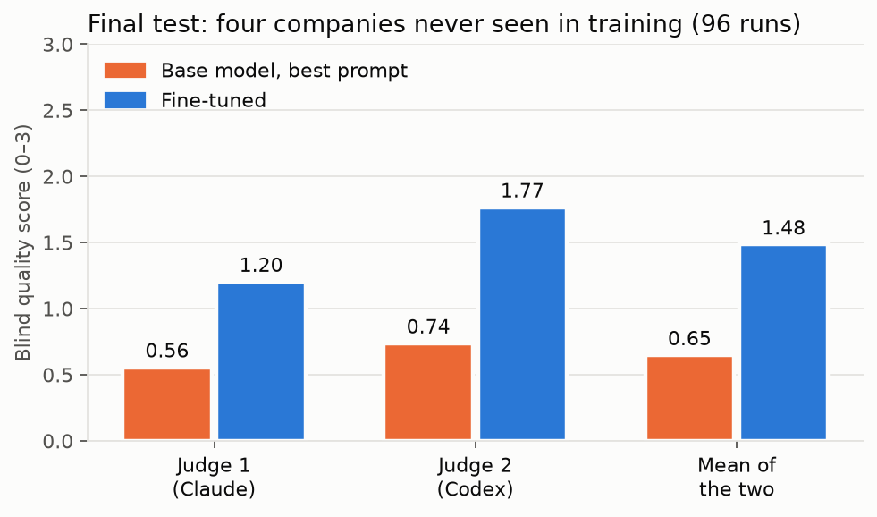
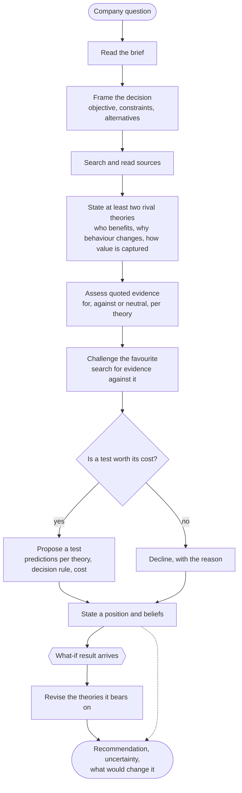
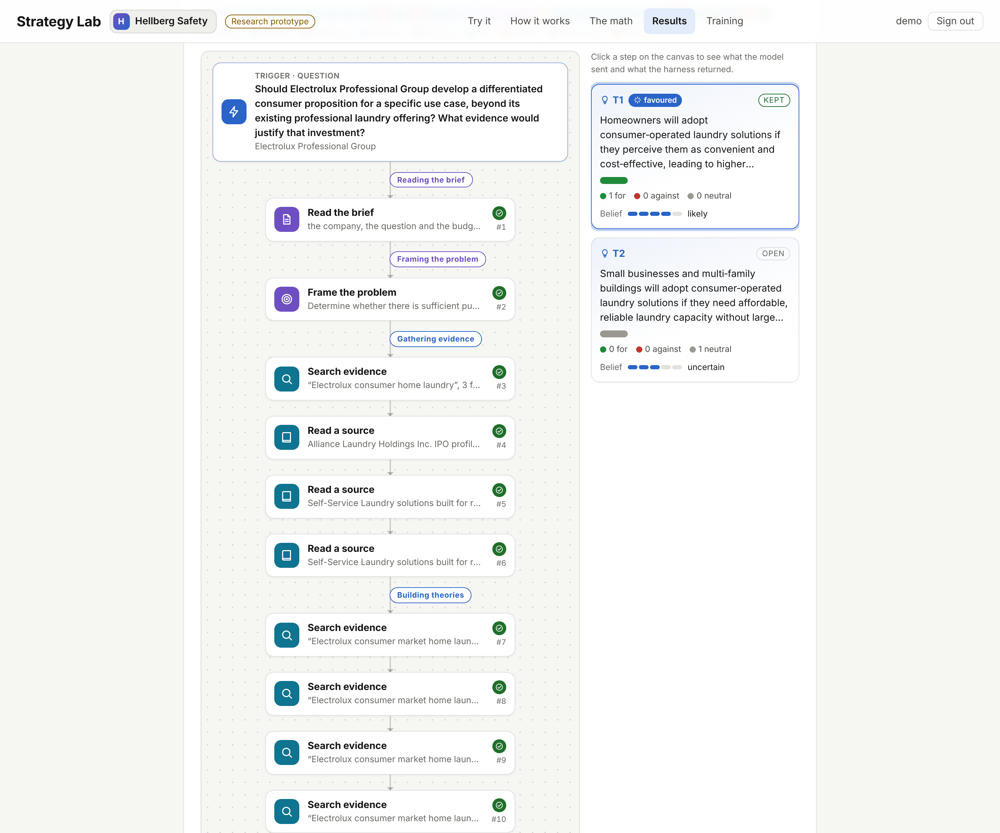
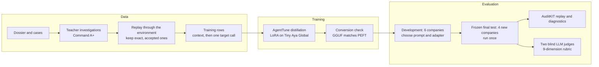
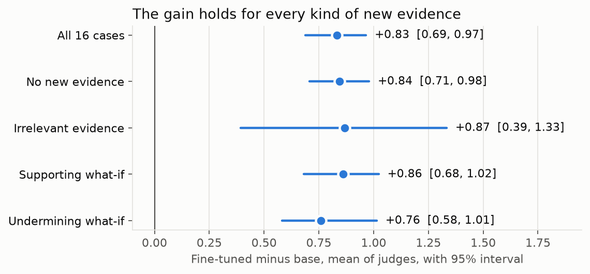
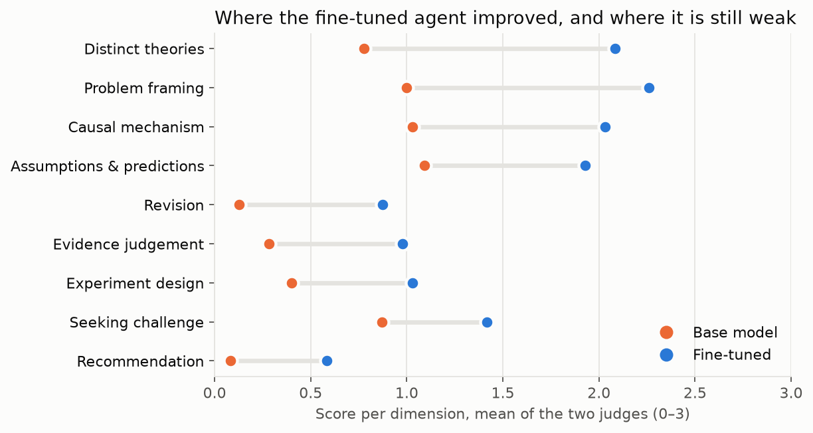

# Aemon: a strategy-investigation agent

*Weigh what is known. Test what is not.*

Aemon is Tiny Aya Global fine-tuned on teacher investigations to investigate strategy questions the way a careful analyst would. The name is a nod to Maester Aemon, a counsellor known for sound judgement in unusual situations.

<picture>
  <source media="(prefers-color-scheme: dark)" srcset="docs/figures/quality-dark.png">
  
</picture>

## The problem

A manufacturer asks whether to take its technology into a new market: should a maker of professional laundry machines
build something for households, should a water-membrane company sell to consumers? Language models answer such
questions with consulting prose: a list of factors, a confident market size with no source, and evidence gathered only
for the answer they started with.

Good strategy work looks different. It frames the decision and its real alternatives (including doing nothing),
states rival theories of *who* would change their behaviour and *why*, derives predictions that tell those theories
apart, weighs quoted evidence for and against each, looks hardest for evidence against its favourite, proposes a test
with a decision rule when information is worth its cost, and revises when new evidence arrives.

This project teaches that procedure to a small open model. The agent works inside an environment that enforces it:
every quote must match a source, every theory must give a distinct causal explanation, and a simulated what-if result
may change a belief but can never support a recommendation about real demand.

| | |
|---|---|
| Evidence dossier | 1,334 public records (935 independent observations, 399 company claims) |
| Cases | 153 company questions on 68 companies, some with a what-if result that arrives mid-investigation |
| Student | Tiny Aya Global (CohereLabs), with a 121 MB LoRA adapter |
| Teacher | Command A+, run through the same environment |
| Training data | 3,891 rows from 158 accepted investigations on 57 companies, plus 51 correction rows |
| Final test | 4 companies never used for training or selection, 16 cases, 3 attempts, 96 runs |

## How the agent works



Every call goes through a guarded tool. A stage controller offers only the tools of the current stage, and a call
that breaks a rule (a misquoted source, a repeated search, a recommendation resting on simulated evidence) is refused
with the reason, so the agent can correct itself.

The included Aemon runs the agent locally for people who are not analysts: the recommendation comes first, with
how sure it is, then charts counted from the investigation (how likely each explanation was judged, the sources for and
against each, the mix of independent sources and company claims, the test's cost against its budget), every source with
its quote, and a full step-by-step trace. Follow-up questions are answered from the investigation's own sources, notes
can be remembered per company or project, every report downloads as a PDF, and a mind map shows all investigations.



## How it was trained and evaluated



## Results

Evaluated once on four companies never used for training, prompt development or model selection: 16 cases (each
company with no new evidence, irrelevant evidence, and a supporting and an undermining what-if result), three
attempts each, 96 runs. Quality is a blind rubric of nine dimensions scored 0 to 3 (problem framing, causal mechanism,
distinct theories, assumptions and predictions, evidence judgement, seeking challenge, experiment design, revision,
recommendation), averaged per investigation.

| | Base model (best prompt) | Fine-tuned | Difference, paired, 95% interval |
|---|---|---|---|
| Judge 1 (Claude) | 0.56 | 1.20 | +0.64 [0.51, 0.77] |
| Judge 2 (Codex) | 0.74 | 1.77 | +1.03 [0.87, 1.18] |
| **Mean of the two judges** | **0.65** | **1.48** | **+0.83 [0.69, 0.97]** |
| Investigations finished | 4 of 48 | 28 of 48 | |

Intervals resample whole cases. The two judges rank the investigations alike (Spearman 0.94).

<picture>
  <source media="(prefers-color-scheme: dark)" srcset="docs/figures/difference-dark.png">
  
</picture>

**By company** (mean of judges): Aquaporin +1.10, Simonelli +0.98, RATIONAL +0.66, Electrolux Professional +0.60.

**By new evidence** (mean of judges): none +0.84, irrelevant +0.87, supporting +0.86, undermining +0.76.

<picture>
  <source media="(prefers-color-scheme: dark)" srcset="docs/figures/dimensions-dark.png">
  
</picture>

The largest gains are in distinct theories, problem framing and causal mechanism; recommendation, revision, evidence
judgement and experiment design improve but remain the weakest.

**Scope.** Four companies support only a limited claim about generalisation, and three attempts per case are not
independent replications. The judges are LLMs, and nothing here measures business outcomes. The fine-tuned agent's
weakest dimensions remain the recommendation, revision, experiment design and evidence judgement; 20 of its 48 runs
end before a recommendation. Details: [docs/FINAL_TEST_DIAGNOSIS.md](docs/FINAL_TEST_DIAGNOSIS.md).

**Cost.** One investigation reads about 122,000 prompt tokens and writes about 2,900, in 66 seconds on one A100 slice:
about $0.03 at a median A100 rental price, against $0.25 measured for Claude Opus 5.5 on the same task
([reports/cost/roi.json](reports/cost/roi.json)).

## Components

- **Environment** (`src/strategy_agent/env/`): twelve guarded tools over a dossier of 1,334 public records. Quotes must
  match a source exactly, theories must give distinct causal explanations, and a simulated what-if result may change
  beliefs but cannot support a recommendation. A stage controller offers the tools of the current stage.
- **Training data** (`src/strategy_agent/pipeline/`): teacher investigations replayed through the environment; only
  those that reproduce exactly and reach an accepted finish become rows. 3,891 rows from 158 investigations on 57
  companies, plus 51 correction rows.
- **Training** (`src/strategy_agent/training/train.py`): AgentTune's distillation trainer, LoRA rank 16 on all linear
  layers, two epochs, loss on the target tool call only.
- **Evaluation** (`src/strategy_agent/evaluation/`, `reviews/judge_v1/`): AuditKIT replay and diagnostics on every run;
  blinded judge packets with the key kept apart; each judge qualified first on 20 matched sound and flawed
  investigations.

## Run it

```bash
uv venv .venv --python 3.12
uv pip install --python .venv/bin/python -r requirements.lock.txt \
  --extra-index-url https://download.pytorch.org/whl/cu128 --index-strategy unsafe-best-match
./run_tests.sh
```

Serve the base model with the adapter (GGUF, llama.cpp), then run an investigation or open the app:

```bash
llama-server -m tiny-aya-global-bf16.gguf --lora tiny-aya-global-strategy-lora-bf16.gguf --port 8091 --jinja
python -m strategy_agent.agent.runner --prompt compact --cases hellberg-base --output run.json
./app/run.sh   # Aemon, at http://127.0.0.1:8000 (PDF reports need Chrome or Chromium)
```

## Reproduce

The job scripts in `jobs/` run each stage on a Slurm cluster with A100 GPUs; set `REVISION` to a copy of this code.

1. Teacher investigations: `jobs/command_a_plus.sbatch` (Command A+ Q4_K_M with llama.cpp).
2. Rows and training: `NAME=final COMPACT=1 ROW_PROMPT=compact EPOCHS=2 SAVE=50 sbatch jobs/train_after_teacher.sbatch`.
3. Conversion check: the GGUF adapter is replayed against the PEFT adapter (`jobs/diagnose_conversion.sbatch`,
   `src/strategy_agent/evaluation/conversion_gate.py`).
4. Evaluation: `jobs/eval_adapter.sbatch` with `SPLIT=heldout ATTEMPTS=3`, once with the adapter (`PROMPT=compact`) and
   once without (`PROMPT=staged`).
5. Judging: `python -m strategy_agent.evaluation.judge_packets`, `reviews/judge_v1/run_campaign.py`,
   `python -m strategy_agent.evaluation.judge_report`. All reports are in `reports/judge/`.

The dossier in this repository keeps each record's source, URL and date with a short quote (its first sentence, at
most 25 words), so runs read shorter excerpts than the originals.

## Licence

Code: Apache 2.0. The adapter derives from Tiny Aya Global and is CC-BY-NC-4.0.
