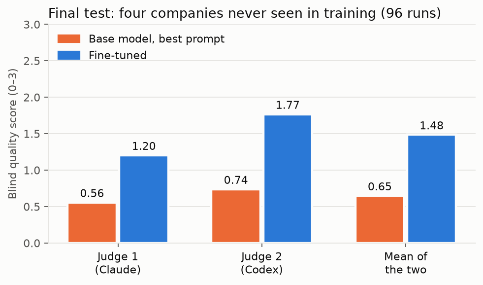
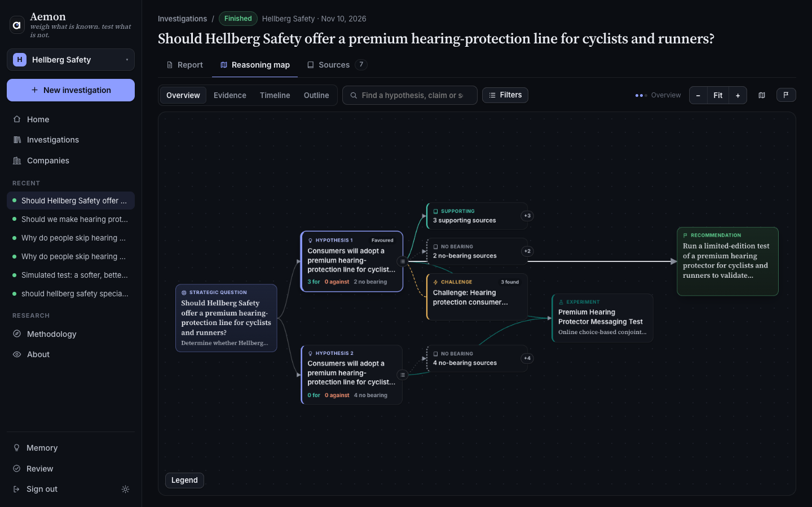
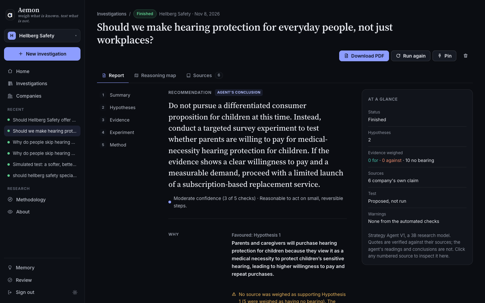

# aemon

<picture>
  <source media="(prefers-color-scheme: dark)" srcset="docs/figures/aemon-wordmark-dark.png">
  
</picture>

*weigh what is known. test what is not.*

**Teaching a 3B model to investigate a strategy question, with AgentTune and AuditKIT.**
Team Two-eyed Ravens · Lexsi AI Hackathon, Track 3 (Agentic Fine-Tuning) · November 2026

> **Result, run once.** On four companies it never saw, with the same environment, tools, stage controller and
> budgets for both arms, the fine-tuned Tiny Aya agent scored **1.48** against the best-prompted base model's **0.65**
> on a 0–3 blind rubric, the mean of two LLM judges: **+0.83**, 95% interval 0.69 to 0.97 over cases and 0.44 to 1.23
> resampling whole companies, higher at every company. A second frozen test on twelve more companies gave
> **+0.52 [0.33, 0.70]**. These are version 1's run-once results.
>
> **Afterwards.** The final system, built after both tests by adding a second adapter and decoding-time guards, so its
> numbers are not held out, scores **+1.02** and **+1.11** over the base model on the same cases and finishes **46 of
> 48** and **65 of 72** investigations (the base model 4 and 2). Claude Haiku 5.5, a closed model run through the same
> environment, scores higher still (**2.28** against the final system's 1.62) at a quarter of the cost; what aemon
> offers instead is a small open-weights model (CC-BY-NC 4.0, non-commercial) that runs offline, with the case data
> kept on the machine.

## 🎬 Watch the Demo

<a href="https://youtu.be/Uow3miSSIIY">
  
</a>

The video shows aemon at work: its agentic investigations, the interactive reasoning map, and the AI research behind
them. Click the thumbnail to watch it on YouTube.

| | |
|---|---|
| **Live demo** | **[huggingface.co/spaces/HatemSaadallah/aemon](https://huggingface.co/spaces/HatemSaadallah/aemon)** (pick any username to sign in, no password; it runs the final system on two CPU cores and sleeps when idle, so the first page takes a moment; finished investigations open at once, a new one takes a while, and it runs one at a time for everyone) |
| Model | [two-eyed-ravens/aemon](https://huggingface.co/two-eyed-ravens/aemon) |
| Dataset | [two-eyed-ravens/aemon](https://huggingface.co/datasets/two-eyed-ravens/aemon) |
| Collection | [aemon: a strategy-investigation agent](https://huggingface.co/collections/two-eyed-ravens/aemon-a-strategy-investigation-agent-6af71da6a81fe397ad0b38dd) |
| Article | [huggingface.co/blog/HatemSaadallah/aemon](https://huggingface.co/blog/HatemSaadallah/aemon) |
| Demo video | [youtu.be/Uow3miSSIIY](https://youtu.be/Uow3miSSIIY) |
| Paper | [docs/PAPER.pdf](docs/PAPER.pdf) |
| Every test run, browsable | [first test](docs/replays/final/README.md) (96 runs) and [second test](docs/replays/test2/README.md) (144 runs), base and fine-tuned side by side, no GPU needed |
| Every decision, dated | [docs/DECISIONS.md](docs/DECISIONS.md) |

**Version 1, frozen tests run once**

| **+0.83** | **+0.52** | **$0.03** |
|:---:|:---:|:---:|
| blind quality over the best-prompted base model on the first frozen test (0–3 scale, 95% interval 0.69 to 0.97; 0.44 to 1.23 resampling whole companies) | on a second frozen test, 12 more unseen companies (0.33 to 0.70) | per investigation, self-hosted on one A100 slice, with the case data kept on the machine; 26× faster than its teacher |

**Final system, built after both tests and measured on the same cases: not held out**

| **+1.02** | **46 of 48** | **6× fewer** |
|:---:|:---:|:---:|
| blind quality over the base model on the first test's cases (95% interval 0.92 to 1.10; +1.11 on the second test's) | investigations finished with an accepted recommendation (65 of 72 on the second test), against 4 of 48 for the base model | tool calls per finished investigation, refused calls included (39 against 242); 7.5% of calls refused, against 29% |

**Which aemon is which**

| | What it is | Files | Numbers |
|---|---|---|---|
| **Version 1** | the evaluated adapter: one LoRA on Tiny Aya Global, distilled from Command A+ | `tiny-aya-global-strategy-lora-bf16.gguf` on the [model page](https://huggingface.co/two-eyed-ravens/aemon) (with the PEFT adapter) | +0.83 and +0.52 on the two frozen tests, run once (section 7) |
| **Final system** | what the app and the live demo run: version 1 gathers the evidence, version 3 (continued on a second teacher's runs) reasons, with decoding-time guards that remove failing actions | both adapters (`v3_adapter.gguf` added); `app/run_model.sh` serves them and `app/server.py` sets the guards ([Run it](#run-it)) | +1.02 and +1.11 over the base model on the same cases, measured after the tests (not held out) |
| Experimental variants | adapter-switching rules, a company status check, a recovery controller, corrective distillation, a verification layer, grounded beliefs | runs and judgments under `experiments/` | [docs/FINAL_SYSTEM.md](docs/FINAL_SYSTEM.md); none is in the app |

<picture>
  <source media="(prefers-color-scheme: dark)" srcset="docs/figures/quality-dark.png">
  
</picture>



**A judge's 60-second view**
1. Open the [first test's run gallery](docs/replays/final/README.md): every case, base and fine-tuned side by side, with
   how each run ended and its blind scores.
2. Click the filter "fine-tuned finished, base did not" (25 of 48 pairs) and open any pair.
3. Read one investigation end to end: [RATIONAL, by the final system](docs/replays/system_rational-new-evidence-irrelevant_2.md)
   weighs fifteen sources, says what each quote does not show, and recommends a test before any commitment. Every
   tool call is there, with what the environment refused and why.
4. Section 7 has the full results, what still fails, and why.

**Paired, case by case.** On the first test the fine-tuned agent scored higher than the base model on all **16 of 16
cases** and in 44 of 47 paired runs (exact sign test, p = 2.5e-10); on the second test on 20 of 24 cases and 49 of 72
runs (`reports/judge/*/paired_counts.json`, mean of two judges).

**In brief**
- **What it is.** A small open-weights model (3.35B; CC-BY-NC 4.0, non-commercial) that runs a strategy investigation
  as an auditable procedure, locally: it frames the decision, states rival causal explanations, weighs evidence for and
  against each, designs a test with a decision rule, and recommends. The environment checks every step: a quote that
  is not word for word in its source is refused, rival explanations must differ, and a simulated result cannot stand
  in for real evidence.
- **How it was made.** Command A+ ran investigations through the same tools; only runs that replay exactly became
  training rows; AgentTune distilled them into a LoRA adapter; AuditKIT replays every evaluation run.
- **What was measured.** Two frozen, run-once tests on 16 unseen companies, scored blind by two LLM judges that first
  had to rank sound investigations above flawed ones. The gain holds when whole companies are resampled (0.44 to 1.23)
  and on the stages both runs reached (+0.92).
- **Efficiency and cost.** Per finished investigation version 1 needs 61 tool calls against the base model's 242, the
  final system 39; refused calls fall from 29% to 7.5%. About $0.03 and 66 seconds per investigation on one A100 slice.
- **Against a closed model.** Claude Haiku 5.5 through the same environment scores higher than the final system (2.28
  against 1.62) and costs less ($0.008 per investigation). The small open model's case is control: offline, the case
  data kept on the machine, weights that can be audited and changed. It learned the procedure; the recommendation is
  where it is weakest, and its teacher's audit shows why (section 7).

The name is a nod to Maester Aemon, a counsellor known for sound judgement in unusual
situations.

## The app

Try it at the [live demo](https://huggingface.co/spaces/HatemSaadallah/aemon), or run it yourself:
`./app/run.sh` starts the interface at http://127.0.0.1:8000. Pick a company, ask a question, and watch the
investigation step by step, then read the report, the reasoning map and the sources. By default it runs the
two-adapter system with the loop guards and evidence first (section 7).

**What it is for.** A first pass that an analyst can check, not a verdict. Every claim in the report links to a
quote that the environment verified word for word against its source; rival explanations are set side by side with
the evidence for and against each; and where the evidence runs out, the report proposes a test with a decision rule.
It runs on a laptop or one small GPU, so the case material never leaves the machine.



**Contents:** [1 Problem and approach](#1-problem-and-approach) · [2 Hackathon repositories used](#2-hackathon-repositories-used) ·
[3 Models and licences](#3-models-and-licences) · [4 Data, cases and licences](#4-data-cases-and-licences) ·
[5 Model artifacts](#5-model-artifacts) · [6 Data artifacts](#6-data-artifacts) ·
[7 Experiments and findings](#7-experiments-and-findings) · [8 With more credits](#8-with-more-credits) ·
[9 Team](#9-team) · [Run it](#run-it) · [Reproduce](#reproduce)

---

## 1. Problem and approach

Asked whether a manufacturer should take its technology into a new market, language models tend to produce
consulting prose: lists of factors, confident market sizes with no source, and evidence collected only for the answer
they started with. Strategy research describes a better habit (Camuffo, Cordova, Gambardella and Spina, 2020, *A Scientific
Approach to Entrepreneurial Decision Making*, Management Science; Camuffo, Gambardella and Pignataro, 2024,
*Theory-driven strategic management decisions*, Strategy Science): frame the decision and its real alternatives; state rival causal
theories of who would change their behaviour and why; derive predictions that tell the theories apart; look for
evidence against the favoured theory; design a test with a decision rule when information is worth its cost; and
revise when new evidence arrives.

**Track 3 problem statements:** 3, *agentic distillation* (a stronger teacher's agent trajectories distilled into a
small local student), and 7, *business workflow and decision agents* (a multi-step investigation with rules and a full
audit trail). *Efficient trajectories* (2) came out as a measured result: 61 tool calls per finished investigation
against the base model's 242, and 39 for the final system.

**The question we test:** can agentic fine-tuning teach that procedure to a small model, beyond what a stage controller
and the best prompt already achieve?

**How the agent carries the procedure out.** In words, with tools and evidence. Neither the agent nor the harness
computes a Bayesian update, which would need an invented network and invented numbers; instead, when it states its
position and again after a what-if result, the agent rates each theory on a five-point scale from very unlikely to
very likely, a signal within one run rather than a calibrated probability. The framework behind the procedure
(Camuffo, Gambardella and Pignataro, 2024, who formalise a theory as a restriction on beliefs) is worked through in
[docs/PAPER.pdf](docs/PAPER.pdf), section 2.

**The setup.**
- **An investigation environment** with twelve tools (`read_brief`, `frame_problem`, `search_evidence`, `read_source`,
  `add_theory`, `assess_evidence`, `challenge_theory`, `propose_test`, `decline_test`, `state_position`,
  `revise_theory`, `finish`) over a dossier of public records (1,334 when version 1 was trained and first tested; 1,958 now). Quotes must match a source exactly; theories must
  give distinct causal explanations; a simulated what-if result may change beliefs but cannot support a recommendation
  about real demand. Refused calls return the reason.
- **A stage controller** that offers the tools of the current stage: brief, frame, read, theories, assessment,
  challenge, test, position, new evidence, conclusion.
- **A teacher**, Command A+ (Apache 2.0), run with llama.cpp on an NVIDIA A100 (80 GB) through the same tools. Every teacher
  investigation is replayed against the environment, and only investigations that replay exactly and reach an
  accepted finish become training data.
- **The student**, Tiny Aya Global, fine-tuned with AgentTune (LoRA) on the teacher's tool calls, then evaluated with
  AuditKIT, executable checks and two blind LLM judges.

## 2. Hackathon repositories used

**AgentTune** (`src/aemon/training/train.py`, `training/masking_gate.py`)
- `agenttune.agentic.distill_trainer.create_distill_trainer` builds the distillation trainer (TRL SFT with PEFT LoRA)
  from our rows; `agenttune.agentic.events` (`Event`, `EventLog`) is the format each evaluated run is converted to
  for AuditKIT.
- Loss is computed only on the target tool call; the context is masked. A masking gate checks this on real rows before
  any training run.

**AuditKIT** (`src/aemon/evaluation/diagnostics/audit.py`)
- `AgentEvalRunner`, `AgentCase`, `AgentEvalSpec` and `episode_from_eventlog` run every evaluation episode through
  AuditKIT; a `CustomPredicate` replays the full event log through our environment and requires every tool result to
  reproduce.
- Diagnostic scorers on every run: `tool_call_validity`, `redundant_tool_calls`, `agent_loop_detection`,
  `tool_permission`. Every development and final report carries an `auditkit` block; all 22 run reports in `reports/judge/` show 0 replay mismatches.

**CuratorKIT** (`src/aemon/rows/curate.py`)
- Decides which training rows to keep and never rewrites one: exact deduplication on (state, target call) and its
  secrets gate, with its run record (manifest, provenance, checksums). On version 1's rows it keeps 3,958 of 4,302;
  all 344 dropped rows are exact duplicates. It was added after the evaluated adapters were trained, for the next
  training run, so the results below do not depend on it.

The three connect: AgentTune trains on rows built from teacher runs that replay exactly in our environment; every
evaluated run is converted to AgentTune's event-log format and replayed by AuditKIT against the same environment; and
CuratorKIT filters the rows.

## 3. Models and licences

| Model | Role | Version | Licence |
|---|---|---|---|
| Tiny Aya Global (CohereLabs) | student | `CohereLabs/tiny-aya-global`, revision af89d21; bf16 GGUF for evaluation | CC-BY-NC-4.0 |
| Command A+ (Cohere) | teacher | Q4_K_M GGUF (about 135 GB), weights sha256 recorded in every row | Apache 2.0 |
| Claude (Anthropic, `claude-opus-5-5`) | blind judge; earlier, a workflow control | API | proprietary; **no Claude output is ever training data** (provider terms), enforced by the provenance checks |
| Codex (OpenAI, `gpt-6-astra`, codex-cli 0.166.0) | blind judge | CLI, sandboxed, no repository access | proprietary; evaluation only |
| DeepSeek V4-Pro (`deepseek-v4-pro`) | second teacher, for version 3 (the final system's reasoner) | hosted API | proprietary; its investigations pass the same replay checks |
| Claude Code (`claude-opus-5-5`) and Codex (`gpt-6-sol`) | blind judges for the final system's comparisons | CLI, no tools, no repository access | proprietary; evaluation only; each qualified separately (19 of 20 and 20 of 20) |
| Claude Haiku 5.5 (`claude-haiku-5-5`) | closed-model baseline on both test sets | API, effort medium, the same environment and limits as every arm | proprietary; evaluation only; **never training data** |

## 4. Data, cases and licences

- **Dossier** (`data/dossier/evidence.json`): public records, each with its URL, date and an excerpt. Version 1 was
  trained and first tested on 1,334 of them (935 independent observations, such as standards, regulatory filings,
  studies and trade press; 399 company claims, kept apart so a theory cannot rest only on what a company says about
  itself). With the second test's companies and the later training cases it now holds 1,958 (1,246 and 712). Records
  written after a decision date are flagged.
- **Cases**: when version 1 was trained, 137 development cases on 64 companies, plus 16 held-out cases on 4 companies
  (207 development cases on 99 companies now, after the cases written for version 3). Each case is a company and a
  question with search and test budgets, and some deliver a what-if result after the agent states a position
  (irrelevant, supporting or undermining). Every case declares in advance whether a test is worth its cost.
- **Splits by company**: for version 1, 58 training companies, 6 validation companies (Hellberg, Neumann, Jotun, Tanita, Deere, ACR)
  for the development choices, and 4 final-test companies (Aquaporin, Electrolux Professional, RATIONAL, Simonelli),
  frozen by digest (`docs/final_test_freeze.json`, dce26d4f…) before any model ran on them.
- **Training data**: 174 accepted teacher investigations gave 4,302 rows. Training used the 3,891 rows from 158
  investigations on 57 training companies, plus 51 correction rows (the teacher showing a valid next step from a state
  where the student had looped); the 411 rows on validation companies were kept out. Other totals below count
  different sets: 223 is every finished teacher investigation, 205 those on training companies.
- **Second test set**: 24 cases on 12 further companies, frozen by digest (`docs/test2_freeze.json`) before any run.
- **Rights**: excerpts are short quotations from public sources (median 24 words, at most 100), each with its
  publisher and link. The dossier is published in full, so anyone can rerun what the evaluated runs read.

### What the environment defends against, and what it does not

The threats are to the investigation's honesty, not to a user. The environment defends against the ones we saw the
teacher and the student commit: **fabricated quotes** (a quote is accepted only if it is word for word in its source,
and the final system picks quotes from the source's own sentences); **simulated results standing in for evidence** (a
what-if result can move a belief but cannot be cited in a recommendation, and a finish that rests on one is refused);
**outcome leakage from post-dated sources** (records written after a case's decision date are flagged, and the teacher
audit counts recommendations that cite them); **a company's claims about itself passing as evidence** (the dossier keeps
399 company claims apart from 935 independent observations, and the final system can label such a record only as a
company assertion); and **invented numbers** (a mechanical check flags a figure that appears in no cited source; the
report shows it to the reader rather than blocking the run). Every call is logged and replayable, so a reader can
check any of this after the fact.

It does not defend against a **poisoned dossier**: the checks verify that a quote is in its source, not that the source
is true, so a false record that enters the dossier is quoted faithfully. It does not defend against an **adversarial
user** who writes a case to steer the recommendation, or against prompt injection carried by a source excerpt, which
the model reads as text. And the judges are language models that can be gamed by fluent prose; the qualification check
and the mechanical checks limit that, the human review we did not do would limit it more.

## 5. Model artifacts

Collection: [aemon: a strategy-investigation agent](https://huggingface.co/collections/two-eyed-ravens/aemon-a-strategy-investigation-agent-6af71da6a81fe397ad0b38dd).
Model: [two-eyed-ravens/aemon](https://huggingface.co/two-eyed-ravens/aemon)
(a derivative of Tiny Aya, so CC-BY-NC-4.0):
- the LoRA adapter (`adapter_model.safetensors`, `adapter_config.json`; sha256 740c4a9b…);
- the converted GGUF adapter for llama.cpp (`tiny-aya-global-strategy-lora-bf16.gguf`, sha256 41794b57…), the exact
  file evaluated on the final test;
- the tokenizer, chat template and model card. Training and evaluation configurations and the job scripts are in the
  code repository.

## 6. Data artifacts

Dataset: [two-eyed-ravens/aemon](https://huggingface.co/datasets/two-eyed-ravens/aemon)
(in the same collection):
- the training rows: 4,302 from the Command A+ teacher, 51 correction rows, and 3,611 (plus 262 for validation) from
  the DeepSeek V4-Pro teacher, each bound to its teacher episode;
- the dossier in full (1,958 records, byte-identical to the one in this repository) and every case: 207 development,
  16 final-test and 24 second-test cases, with both freeze files;
- the second teacher's investigations (transcripts, provenance, request logs);
- evaluation runs, blinded judge packets, judge outputs and reports for every campaign: development, both frozen
  tests, version 3, adapter switching, the combined system, the loop guards and evidence first;
- `MANIFEST.json`, with the sha256 of each private original and of its published copy.

## 7. Experiments and findings

**The metrics, and why.** Every arm is measured the same way, before and after: **finished investigations** (did the
run reach an accepted recommendation: the reliability of the workflow), **tool calls per finished investigation and
the share of calls refused** (wasted actions: a refused call is a broken rule), and **blind quality** on a
nine-dimension 0–3 rubric from two qualified LLM judges (whether the investigation is any good: the only measure that
tells a finished run from a sound one). **Cost per investigation**, self-hosted against closed-model billing, is the
ROI comparison.

### Getting to a first result
The untrained model could not do the task: in an open workflow it quit after a step or two, and under the stage
controller it stalled by repeating itself. Three changes got us to a first adapter: a compact state in place of the
full chat history (late-stage rows exceeded 8,192 tokens and were refused rather than truncated), correction rows and a
state that says plainly that rereading a source returns the same text (the first fine-tuned runs looped on refused
calls at temperature 0), and a stronger teacher (Aya Expanse 32B followed the workflow but reasoned weakly; Command A+
replaced it). Details: [docs/DECISIONS.md](docs/DECISIONS.md), 1 to 7 November.

### Controls that the result rests on
- **Conversion check.** Every evaluated adapter was converted to GGUF and replayed against the PEFT adapter on the GPU:
  effect cosine at least 0.99 and probability-weighted residual at most 0.15 on every point, plus a weight-file audit.
  The final adapter passed (cosine 0.9990, residual 0.080), and the evaluated file is byte-identical to the gated one.
  A first, cruder check was retired on 6 November because its "conversion adds at most 0.15 to the base gap" criterion
  measured kernel noise as much as conversion error; the final-test job still ran it, so
  `reports/judge/final/final_test_trained_conversion.json` says `passed: false` under that retired criterion while
  passing the other four. The gate that counts is the replay above (`reports/conversion/`; note beside the file).
- **Judges.** Each judge first scored 20 matched pairs of investigations, sound and flawed, and had to rank the sound
  one higher in at least 17. Claude did so in 20 of 20 (after its output limit was raised and it was requalified),
  Codex in 20 of 20; the final system's judges, Claude Code and Codex on `gpt-6-sol`, in 19 of 20 and 20 of 20.
  Packets carry no model name; the key stays outside the judges' reach.

### Development (6 validation companies, 15 cases, one attempt each)

| Arm | Finished | Quality, mean of two judges |
|---|---|---|
| Base, compact prompt | 0 of 15 | 0.14 |
| Base, staged prompt | 0 of 15 | 0.43 |
| Earlier adapter | 6 of 15 | 1.09 |
| **Final adapter** | 7 of 15 | **1.29** |

By the preregistered rule (higher mean judge score) the staged prompt became the base and the final adapter the
trained arm. The final adapter scored above the earlier one (+0.20), though not by a clear margin.

### Final test (4 held-out companies, 16 cases, 3 attempts, 96 runs, run once)

| | Base, staged prompt | Fine-tuned | Difference, paired, 95% case-cluster bootstrap |
|---|---|---|---|
| Claude | 0.56 | 1.20 | +0.64 [0.51, 0.77] |
| Codex | 0.74 | 1.77 | +1.03 [0.87, 1.18] |
| **Mean of judges** | **0.65** | **1.48** | **+0.83 [0.69, 0.97]** |
| Finished investigations | 4 of 48 | 28 of 48 | |

- Every company is higher under both judges (mean of judges: Aquaporin +1.10, Simonelli +0.98, RATIONAL +0.66,
  Electrolux Professional +0.60), and every kind of new evidence (no new evidence +0.84, irrelevant +0.87, supporting
  +0.86, undermining +0.76).
- The judges agree on the ordering (Spearman 0.94 over 95 runs scored by both).
- The largest gains are in distinct theories, framing, causal mechanism, and assumptions and predictions; the weakest
  dimensions for the trained agent remain the recommendation, revision, experiment design and judging evidence.

Per rubric dimension and per kind of new evidence: `docs/figures/dimensions-light.png`, `docs/figures/difference-light.png`.

**How each run ended** (48 runs per arm; a run is refused a call when it breaks a rule, and stops after repeated
refusals, at the context limit or at the turn limit):

| | Base, staged prompt | Fine-tuned |
|---|---|---|
| Finished with an accepted recommendation | 4 | 28 |
| Stopped after repeated refused calls | 19 | 11 |
| Stopped at the context limit | 25 | 0 |
| Stopped at the turn limit (45) | 0 | 9 |
| Mean calls per run | 20.2 | 35.4 |
| Calls per finished investigation (refused calls included) | 242 | **61** |
| Refused calls, all runs | 279 | 242 |
| Share of calls refused | 29% | **14%** |

**Two stricter checks** (`scripts/release/robustness.py`, `reports/judge/robustness.json`, from the saved judgments):
resampling whole companies instead of cases, since the 16 cases are 4 companies with 4 variants each, keeps the
interval above zero on both tests (first test 0.44 to 1.23 by the company-cluster t interval, 0.63 to 1.05 by
bootstrap; second test from +0.25); and scoring each pair only on the rubric dimensions both runs reached, which
removes the base model's 25 context-limit stops from the comparison, makes the difference larger, **+0.92 [0.83, 1.01]**
and **+0.90 [0.81, 0.99]**.

### The Track 3 metrics by name: task success, tool-call accuracy, latency

Per company, from the saved runs (`scripts/release/track3_metrics.py`, `reports/track3_metrics.json`). Task success
is the share of runs that finish with an accepted recommendation; tool-call accuracy is accepted calls over all calls
(1 minus the refused share). Latency: version 1 takes 66 seconds per investigation on one A100 40 GB slice, one at a
time (`reports/cost/roi.json`); the other arms were not timed.

| First test | Base model | Version 1 | Final system | Base model | Version 1 | Final system |
|---|---|---|---|---|---|---|
| | *task success* | | | *tool-call accuracy* | | |
| Aquaporin | 2 of 12 | 11 of 12 | 12 of 12 | 81% | 93% | 97% |
| Electrolux Professional | 1 of 12 | 6 of 12 | 12 of 12 | 66% | 79% | 91% |
| RATIONAL | 1 of 12 | 6 of 12 | 12 of 12 | 67% | 94% | 95% |
| Simonelli | 0 of 12 | 5 of 12 | 10 of 12 | 70% | 77% | 86% |
| **All 48 runs** | **4** | **28** | **46** | **71%** | **86%** | **93%** |
| **Second test, all 72 runs** | **2** | **32** | **65** | **64%** | **75%** | **91%** |

On the second test version 1 is higher than the base model in task success for 11 of 12 companies and in tool-call
accuracy for 9 of 12 (`reports/track3_metrics.json` has every row); the final system is higher in both for every
company but one (Testo, tool-call accuracy 70% against 65%).

### Cost: the fine-tuned agent against a closed model (`reports/cost/roi.json`)

Measured on the final test, one investigation by the fine-tuned agent reads about 121,700 prompt tokens and writes about
2,900 over 35 tool calls, in **66 seconds on one A100 slice**, one investigation at a time: about 54 an hour.

| | per investigation | per 10,000 investigations |
|---|---|---|
| **Fine-tuned Tiny Aya, self-hosted** (A100 40 GB, Oct 2026 median $1.76/h; range $0.89-$3.67) | **$0.032** ($0.016-$0.068) | **$324** (184 GPU hours; $164-$676) |
| Claude Opus 5.5, measured on our earlier control run (15 investigations, $3.73) | $0.25 | $2,483 |
| Claude Opus 5.5, the same token volume at list price, no caching ($4 / $20 per million) | $0.54 | $5,442 |
| **Claude Haiku 5.5, measured on both test sets** (120 investigations; $1.06 in all with the runs lost to API errors; effort medium, with caching) | **$0.0084** | **$84** |

- Self-hosting costs about **8 times less than the measured Opus run**; per finished investigation (28 of 48) about
  $0.056. **Claude Haiku 5.5 costs less than self-hosting, and scores higher** (next section but one): the case for
  self-hosting is running offline, with the case data kept local and weights that can be audited, not price.
- Opus and Sonnet were not run on the test cases, so their rows compare cost, not quality. The teacher, Command A+,
  took about 29 minutes per investigation on a full A100, so the student runs roughly **26 times faster** per GPU.
  Serving several investigations at once, which llama.cpp supports, was not measured.

Prices: Anthropic list prices and GPU aggregator snapshots, October 2026; both change often.

### What still fails, and why (`docs/FINAL_TEST_DIAGNOSIS.md`, `docs/RELIABILITY_REPORT.md`)
Few runs pass every mechanical check (1 of 48, as rare as in the teacher's own runs, 1 of 223), and 20 of 48 stop
before a recommendation. Most failures trace to behaviour the training data never showed: no training example declines
a test, so the student never does, even for Aquaporin, whose insolvency is in the dossier and which no run of either arm
read; only 8 of 205 teacher investigations had a supporting or undermining what-if result, so the student fumbles the
rest; eight runs try to finish citing only the simulated result; nine reach the turn limit, eight of them rereading the
same sources. An audit of the 158 teacher investigations found the same weaknesses the judges score lowest in the
student: 74% of the teacher's recommendations use a number from no source (the student: 21% and 31% on the two tests),
38% of its evidence kinds match the dossier's annotation, and in 68% of its historical cases the recommendation cites a
source published after the case date. Distillation passed on the procedure and the teacher's judgement with it; when
we tried to correct the teacher's mistakes with the same teacher, it made them again. A student can be filtered for
following the rules, not for judging well. What we did about each failure since is in
[docs/FINAL_SYSTEM.md](docs/FINAL_SYSTEM.md).

### Second frozen test (12 new companies, 24 cases, 3 attempts, 144 runs, run once; `docs/test2_freeze.json`)
A second test on companies never used for training, development or the diagnosis above. It was frozen before any run,
under the same judges, rubric and rule.

| | Base, staged prompt | Fine-tuned | Difference, paired, 95% case-cluster bootstrap |
|---|---|---|---|
| Claude | 0.48 | 0.89 | +0.41 [0.24, 0.57] |
| Codex | 0.66 | 1.29 | +0.63 [0.43, 0.84] |
| **Mean of the two judges** | **0.57** | **1.09** | **+0.52 [0.33, 0.70]** |
| Finished investigations | 2 of 72 | 32 of 72 | |
| Finished and passing every check | 1 | 4 | |

- The fine-tuned agent is higher for 10 of 12 companies on the mean of judges.
- Every rubric dimension is higher under both judges, most of all problem framing, revision and distinct theories;
  the recommendation (0.03 → 0.44), experiment design (0.22 → 0.53) and judging evidence (0.35 → 0.47) gain least.
- The two judges rank the runs alike (Spearman 0.95 over all 144).
- Why smaller than the first test's +0.83: version 1 finished fewer runs here (32 of 72 against 28 of 48), a stage
  never reached scores 0, and the gain is smallest for the four companies where it finished one or two runs of six
  (Franke, Hoshizaki, Dräger, Belimo). On the stages both runs reached, the two tests agree: +0.92 and +0.90.

### The final system
What the app runs: two adapters ("dig then reason") with decoding-time guards. **It was built after both frozen tests
had been run and read**, partly from their failures (the loop guards from the refused calls, most of them the model
repeating itself; evidence first from the judges' lowest-scored dimension), so **version 1's +0.83 and +0.52 remain
the run-once result** and the numbers below are not held out. Each part had its adoption rule registered in
[docs/DECISIONS.md](docs/DECISIONS.md) before it ran and was judged blind by Claude Code and Codex (`gpt-6-sol`); every
table is in **[docs/FINAL_SYSTEM.md](docs/FINAL_SYSTEM.md)**.

**Quality against the base model** (mean of the same two judges, same instrument, base and final system judged in
separate batches; `scripts/release/final_system_vs_base.py`): **1.62 against 0.61, +1.02 [0.92, 1.10]** on the first
test's 48 runs, and **1.67 against 0.56, +1.11 [1.01, 1.20]** on the second's 72, higher at every company (4 of 4 and
12 of 12); each judge alone is above +0.76.

**How it runs** (first test, 48 runs each, same cases, settings and seeds; Claude Haiku 5.5 for reference, next section):

| | Base model | Version 1 | **Final system** | Claude Haiku 5.5 |
|---|---|---|---|---|
| Investigations finished | 4 | 28 | **46** | 44 |
| Investigations finished, second test (of 72) | 2 | 32 | **65** | 63 |
| Tool calls per run | 20.2 | 35.4 | 37.8 | 22.2 |
| Tool calls per finished investigation (refused calls included) | 242 | 61 | **39** | 24 |
| Share of calls refused | 28.8% | 14.3% | **7.5%** | 13.9% |

**What each part adds** (mean of two judges; intervals and every table in [docs/FINAL_SYSTEM.md](docs/FINAL_SYSTEM.md)):
dig then reason is level with version 1 on the first test and **+0.36** over it on the second; the loop guards add
+0.12 [0.00, 0.25] and **+0.21**, with finished runs 27 → 45 and 43 → 69; evidence first adds +0.06 and +0.03, and the
judged evidence score doubles (0.46 → 0.98) on the first test.

What worked: changes that remove a failing action from what the model can produce. Advice to the model did not, and
we also tried, and did not adopt, a company status check, corrective distillation, a recovery controller and a
verification layer ([docs/FINAL_SYSTEM.md](docs/FINAL_SYSTEM.md)).

### Against a closed model: Claude Haiku 5.5 (`experiments/haiku/`)
Registered before it ran ([DECISIONS](docs/DECISIONS.md), 13 November): Claude Haiku 5.5, the cheapest current closed
model, on both test sets through the same environment, tools, stage controller and limits, with the base model's best
prompt (the full transcript; Haiku's context is large enough that it never reaches a limit), effort medium, 3 attempts
per case. Judged blind with the base model, version 1 and the final system by the same two judges. 29 of the 120 runs
were lost to Anthropic API errors (HTTP 500) and rerun; 5 Haiku runs have no Claude Code judgment (rejected by the
instrument's validity check) and are left out of the pairs. Haiku's outputs are never training data.

| Mean of judges (0–3) | Base model | Version 1 | Final system | **Claude Haiku 5.5** | Final system minus Haiku |
|---|---|---|---|---|---|
| First test (48 runs each) | 0.61 | 1.45 | 1.62 | **2.28** | −0.67 [−0.79, −0.52] |
| Second test (72 runs each) | 0.56 | 1.07 | 1.67 | **2.30** | −0.63 [−0.75, −0.52] |

- **Haiku is better on this task**: higher at every company on both sets and on all nine rubric dimensions, most on
  the recommendation (1.95 against 1.06) and the causal mechanism (2.83 against 1.97); Codex alone, not judging its
  own family, gives −0.43 on both sets. It is also cheaper ($0.008 per investigation) and quicker to a finish (24 tool
  calls per finished investigation against 39).
- **What the fine-tuning bought**: a 3B open model from 0.61 to 1.62, about 60% of the way to Haiku from the same
  start. What it offers is control, not quality or price: offline on one GPU or a laptop, the case data kept on the
  machine, weights that can be inspected and trained further. Tables: `experiments/haiku/summary.json`.

### General-capability retention (`reports/retention/`)
What the fine-tuning cost the model outside this environment, measured on 500 MMLU test items (every subject, evenly)
and 300 ARC-Challenge test items, zero-shot, scored by the most probable letter among the first token's top-20
log-probabilities. The three arms are one llama-server process on the evaluated bf16 GGUF, with the adapters' scale
switched between 0 and 1, so weights, prompt and decoding are otherwise identical (`scripts/bench/retention.py`,
`jobs/retention.sbatch`; registered in [docs/DECISIONS.md](docs/DECISIONS.md) before it ran).

| | MMLU (500) | ARC-Challenge (300) | All 800 | Difference from base, 95% bootstrap over items |
|---|---|---|---|---|
| Base Tiny Aya Global | 53.4% | 73.3% | 60.9% | |
| With the version 1 adapter | 53.2% | 73.7% | 60.9% | 0.0 points [−1.3, +1.3] |
| With the version 3 adapter | 53.0% | 74.0% | 60.9% | 0.0 points [−1.4, +1.4] |

The adapters change the answer on 42 and 52 of the 800 items, and the changes cancel: nothing measurable was lost.
Two caveats: 800 items bound the loss at about a point and a half, not less, and this is a zero-shot letter-choice
check, not a generation benchmark. A first run that parsed a short generated reply instead is kept in the decision log
and not used: the base model answered 411 of 800 items without a letter (the fine-tuned model, 0), a formatting
difference that the log-probability scoring removes.

### Limits
- **The mechanical experiment check is too lenient**: 8 of the 9 tests it accepts on development fail stricter
  design screens. The frozen numbers use the original check; later comparisons also report a stricter one.
- **Evidence-kind labels are 75% exact, 83% counting defensible alternatives**, by a blind relabelling of 60
  training records.
- **No human scores.** Every quality number comes from two LLM judges, qualified by ranking sound investigations above
  flawed ones. They agree on the order of runs (Spearman 0.94 on the final test) but not on the level: on the same
  fine-tuned runs Claude scores problem framing 1.62 and Codex 2.90. Read the scores as comparisons between arms, not
  as absolute grades; a strategy researcher's ratings would be the most useful addition.
- **One kind of question.** Every case asks whether a maker of professional equipment should build a consumer
  proposition. "Generalises" here means new companies, not new kinds of strategy question.

Details: [docs/RELIABILITY_REPORT.md](docs/RELIABILITY_REPORT.md) and
[docs/EVIDENCE_KIND_GUIDE.md](docs/EVIDENCE_KIND_GUIDE.md).

### Lessons
- The controller, the guards and replay made the teacher's data trustworthy, and the same machinery made every
  evaluation run auditable. Two qualified blind judges, a frozen plan and a one-shot test kept us from reading noise:
  several development differences that looked real were not, and results did not transfer cleanly between sets.
- Most remaining failures are gaps in the training data, not in the amount of it.
- At run time, removing a failing action from what the model can produce worked; telling the model about its mistake
  did not. Better judgement in the conclusion has to come from better training data.

## 8. With more credits

The diagnosis gives a concrete plan, each part confirmed on development cases before new training examples are chosen,
and measured on fresh evaluation cases, since the four final-test companies have now informed the diagnosis:
1. Justified propose-versus-decline examples, where the decision follows from explicit constraints and the value of
   the information, allowing either decision when warranted.
2. Balanced supporting and contradicting what-if evidence, explicitly linked to the theory it bears on.
3. Recovery from simulated-only citations, separating a hypothetical belief update from the real evidence behind a
   recommendation.
4. Recovery from rereading, using the information already gathered.
5. Searching for the company's current position before theorising (the Aquaporin failure). The [status check](docs/FINAL_SYSTEM.md#a-company-status-check-the-aquaporin-failure)
   does this at run time; training it in should remove its cost in finished runs.

More teacher runs of the same kind would not address these gaps; more of these specific cases would, from a stronger
or human-corrected teacher for evidence judgement, since a teacher's errors pass to the student and cannot be filtered
out afterwards. Before and after would be measured exactly as here: the same frozen judges and rule, on new held-out
companies. What we already tried beyond the final system is in [docs/FINAL_SYSTEM.md](docs/FINAL_SYSTEM.md).

## 9. Team

Team Two-eyed Ravens: Hatem Saadallah and Nour Jennane, Master's students in artificial intelligence and AI
researchers.

Built with AgentTune, AuditKIT and CuratorKIT (Lexsi Labs), Tiny Aya and Command A+ (Cohere), PEFT, TRL and llama.cpp,
on NVIDIA A100 GPUs (40 GB and 80 GB slices, Slurm). Claude (Anthropic) and Codex (OpenAI) served as blind judges and as coding assistants.

---

## Repository layout

```
src/aemon/environment/   the twelve guarded tools, the stage controller, the cases and the dossier search
src/aemon/agent/         the runner, tool schemas, adapter routing, model clients
src/aemon/teacher/       teacher investigations (Command A+ locally, DeepSeek V4-Pro hosted)
src/aemon/rows/          row building, provenance, coverage checks, CuratorKIT curation
src/aemon/training/      AgentTune distillation training, the masking gate
src/aemon/evaluation/    AuditKIT replay and diagnostics, the conversion gate, blind judging
data/dossier/            the public-source dossier the agent searches and quotes
app/                     the interface (FastAPI and React)
deploy/                  the hosted demo (Modal) and the Hugging Face pages
ops/                     MLflow tracking of runs, metrics and adapters
tests/                   the test suites (./run_tests.sh)
jobs/                    Slurm job scripts for every stage
scripts/                 cluster helpers and the release builders (public repository, Hugging Face, replay pages)
reports/                 every result: teacher runs, evaluations, judge packets, outputs and reports
experiments/             the final system's campaigns: runs, packets, judgments and reports
paper/                   the paper's LaTeX source (built to docs/PAPER.pdf)
docs/                    the decisions log, plans frozen before each test, model and dataset cards
```

## See an investigation without a GPU

[docs/replays/](docs/replays/README.md) renders every run of both frozen tests as pages you can read here on GitHub
(96 runs of the first test, 144 of the second), base and fine-tuned side by side, with filters: every tool call, what
the environment accepted or refused and why, the recommendation, and the blind judges' scores. Six are picked out at
the top: a finished run for each company of the first test, the Aquaporin run that misses the insolvency, a run that
stops on refusals, and the untrained base model on the same case. They come straight from the saved reports
(`reports/judge/final/`, `reports/judge/test2/`); `python scripts/release/replay_markdown.py` regenerates them, with
no model or GPU.

## Run it

```bash
uv venv .venv --python 3.12
uv pip install --python .venv/bin/python -r requirements.lock.txt \
  --extra-index-url https://download.pytorch.org/whl/cu128 --index-strategy unsafe-best-match
./run_tests.sh
```

The app looks for the model and the adapters in fixed places and by fixed names (`app/run_model.sh`), so fetch them
like this (Linux; on macOS `brew install llama.cpp` replaces the llama.cpp step):

```bash
# llama.cpp, the release the evaluated runs used
mkdir -p ~/.cache/lexsi/llama-b12032 ~/.cache/lexsi/adapters
curl -L https://github.com/ggml-org/llama.cpp/releases/download/b12032/llama-b12032-bin-ubuntu-x64.tar.gz \
  | tar -xz -C ~/.cache/lexsi/llama-b12032 --strip-components=1   # or the vulkan/cuda build for a GPU

# the 4-bit base model, at the revision the app expects
.venv/bin/hf download CohereLabs/tiny-aya-global-GGUF tiny-aya-global-q4_k_m.gguf \
  --revision a602ea7eeec3a4ad6f77a1b8cf6a53512824922b

# the adapters, saved under the names the app loads
.venv/bin/hf download two-eyed-ravens/aemon tiny-aya-global-strategy-lora-bf16.gguf \
  v3_adapter.gguf --local-dir /tmp/aemon-adapters
cp /tmp/aemon-adapters/tiny-aya-global-strategy-lora-bf16.gguf ~/.cache/lexsi/adapters/final_adapter.gguf   # version 1
cp /tmp/aemon-adapters/v3_adapter.gguf ~/.cache/lexsi/adapters/v3_adapter.gguf                  # version 3

./app/run_model.sh                                        # the model server, port 8091
./app/run.sh                                              # the app, at http://127.0.0.1:8000 (needs Node once, to build);
                                                          # sign in with any username: a new one opens an account
```

With only version 1's adapter present the app runs version 1 alone. One investigation from the command line, against
the same server:

```bash
.venv/bin/python -m aemon.agent.run_investigations --url http://127.0.0.1:8091 --lora-route default=0 \
  --prompt compact --cases hellberg-base --output run.json   # default=0 is version 1
```

PDF reports need Chrome or Chromium.

## Reproduce

The job scripts in `jobs/` run each stage on a Slurm cluster with A100 GPUs; set `REVISION` to a copy of this code.

1. Teacher investigations: `jobs/command_a_plus.sbatch` (Command A+ Q4_K_M with llama.cpp).
2. Rows and training: `NAME=final COMPACT=1 ROW_PROMPT=compact EPOCHS=2 SAVE=50 sbatch jobs/train_after_teacher.sbatch`.
3. Conversion check: the GGUF adapter is replayed against the PEFT adapter (`jobs/diagnose_conversion.sbatch`,
   `src/aemon/evaluation/conversion/gate.py`).
4. Evaluation: `jobs/eval_adapter.sbatch` with `SPLIT=heldout ATTEMPTS=3`, once with the adapter (`PROMPT=compact`) and
   once without (`PROMPT=staged`).
   The trained arm needs `DIAGNOSTIC=1`: the job still runs the first conversion check, retired on 6 November, which
   the final adapter fails on one threshold, so without the flag it exits with code 3 and with it the outputs carry a
   `DIAGNOSTIC_conversion_gate_failed` marker. The adopted check is the second one (step 3), which the adapter passed
   (`reports/conversion/final_gate_v2.json`). `docs/DECISIONS.md` has both entries.
5. Judging: `python -m aemon.evaluation.judging.packets`, `src/aemon/evaluation/judging/judge_v1/run_campaign.py`,
   `python -m aemon.evaluation.judging.report`. All reports are in `reports/judge/`.

The dossier in this repository is the one the evaluated runs read: each record keeps its source, URL and date with
the excerpt the agent quotes from.

## Licence

Code: Apache 2.0. The adapter derives from Tiny Aya Global and is CC-BY-NC-4.0.
