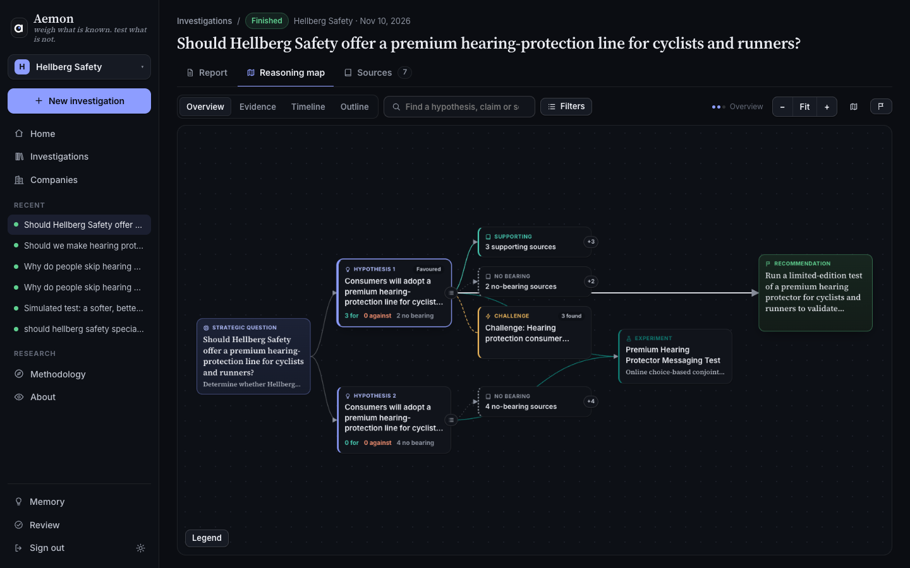

  

# Two-Eyed Ravens

**aemon** teaches a 3B open model to investigate a strategy question the way a careful analyst would: frame the
decision, state rival explanations, weigh quoted evidence for and against each, look for what would prove the
favourite wrong, propose a test when one is worth its cost, and revise when new evidence arrives. Every claim links
to a quote the environment checked word for word against its source, and it runs on a laptop or one small GPU, so the
case material never leaves the machine.

Built for the Lexsi AI Hackathon, Track 3 (Agentic Fine-Tuning), with AgentTune, AuditKIT and CuratorKIT.

| **+0.83** | **+0.52** | **46 of 48** | **39 calls** |
|:---:|:---:|:---:|:---:|
| blind quality over the best-prompted base model on the first frozen test, run once (0–3 scale, 95% interval 0.69 to 0.97) | on a second frozen test, 12 more unseen companies (0.33 to 0.70) | investigations the final system finishes with an accepted recommendation, against 4 of 48 for the base model | per finished investigation, refused calls included, against the base model's 242 |

A closed model, Claude Haiku 5.5, scores higher still through the same tools (2.28 against the final system's 1.62)
at a quarter of the cost. What aemon offers instead is local, offline use with open weights (CC-BY-NC 4.0) and an
investigation you can audit step by step.

## Start here

- **[Live demo](https://huggingface.co/spaces/HatemSaadallah/aemon)**: pick any username, no password. Finished
  investigations open at once; a new one takes a while on CPU.
- **[Article](https://huggingface.co/blog/HatemSaadallah/aemon)**: the write-up in Lexsi's nine sections.
- **[Code and every run](https://github.com/HatemSaadallah/aemon)**: the repository, with every test run readable as
  a page and every decision dated.
- **[Model](https://huggingface.co/two-eyed-ravens/aemon)**: the two adapters for Tiny Aya Global (version 1, evaluated; version 3,
  the final system's reasoner), as PEFT and GGUF files.
- **[Dataset](https://huggingface.co/datasets/two-eyed-ravens/aemon)**: the training rows (split as trained), the dossier, every
  case, and every evaluation run with its blind judgments.
- **[Collection](https://huggingface.co/collections/two-eyed-ravens/aemon-a-strategy-investigation-agent-6af71da6a81fe397ad0b38dd)** · **[Paper](https://github.com/HatemSaadallah/aemon/blob/main/docs/PAPER.pdf)**

## Team

[Hatem Saadallah](https://huggingface.co/HatemSaadallah) and [Nour Jennane](https://huggingface.co/Nour1928),
Master's students in artificial intelligence.
