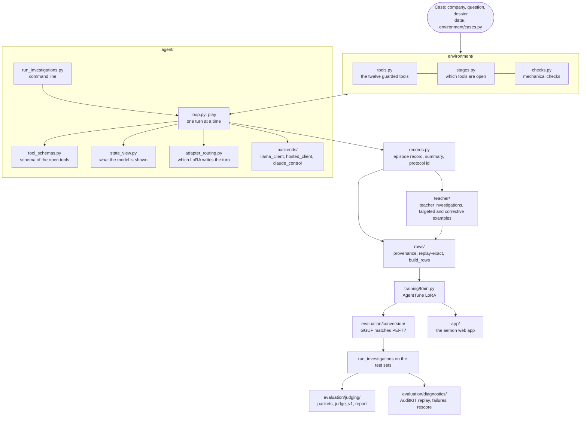

# How the code is organized

The package is `aemon` (`src/aemon/`). Each folder is one domain, and each file holds one concept. Frozen reports
written before 2026-11-11 name the old package, `strategy_agent`; the module map at the end finds the new place of every
old module.

## How an investigation flows

A turn, in words: `loop.play` asks `tool_schemas.schema_for` which tools the stage controller has open, and sends the
messages and that schema to a backend. It parses the reply into one call with `llama_client.parse_call`, has the
environment run it (`Investigation.call` accepts it, or refuses it with a reason), and shows the model the result. In
compact runs it shows the whole state instead (`state_view.state_of`). `records.record_of` turns the finished
investigation into the record every report, row builder and judge packet reads.

## Folders

| Folder | Owns | Entry points |
|---|---|---|
| `common/` | constants (prompts, tool signatures, environment limits), shared types, repository paths | none |
| `environment/` | cases, the evidence dossier and its search, the guarded tools, the stage controller, the checks, live sources for the app | none |
| `agent/` | the loop, tool schemas, the state view, adapter routing, episode records; `recovery.py` (the experimental recovery controller the loop can switch on) | `python -m aemon.agent.run_investigations` |
| `agent/backends/` | llama.cpp client (student and teacher), hosted API client, Claude (positive control and judging only, never a teacher) | none |
| `agent/experimental/` | layers that wrap the evaluated loop in their own process (verify, grounded, novelty, reference); development split only | `python -m aemon.agent.experimental.verify` (and grounded, novelty) |
| `data/` | building the dossier and cases, checking sources, freezing test sets, company splits | `build_dossier`, `verify_sources`, `freeze` |
| `teacher/` | teacher investigations through the same environment (Command A+ on the cluster; DeepSeek for some rounds), targeted and corrective examples, corrections | `targeted`, `corrective`, `corrections`, `hosted_investigations`, `hosted_review` |
| `rows/` | provenance manifest, replay-exact checks, training rows | `build_rows`, `row_coverage`, `stage_check` |
| `training/` | the AgentTune distillation trainer | `train` |
| `evaluation/conversion/` | the conversion gate: does the GGUF adapter behave like the PEFT one? | `check`, `diagnose`, `gate` |
| `evaluation/judging/` | blind judge packets (key kept apart), judge reports, and the frozen judge instrument `judge_v1/` (prompt, rubric, qualification sets, backends, receipts' configuration) | `packets`, `report`; `python src/aemon/evaluation/judging/judge_v1/run_campaign.py` |
| `evaluation/diagnostics/` | AuditKIT replay, failure tables, rescoring, fixed policies, recovery benchmark | `rescore`, `failures`, `fixed_policies`, `recovery_bench`, `recovery_report` |

Outside the package: `app/` is the aemon web app, `jobs/` holds the Slurm jobs, `experiments/` holds one folder per
experiment (each with a README naming its decision entry), `scripts/` has `release/`, `cluster/` and `oneoff/` tools
(`scripts/README.md`), `reports/` holds the recorded results, and `reviews/` holds the recorded review rounds the app
reads.

**Not used by the current pipeline.** These are kept because recorded results came from them, but nothing imports or
runs them now: `evaluation/diagnostics/prefix_eval.py`, `evaluation/diagnostics/recovery_bench.py`,
`evaluation/diagnostics/recovery_report.py`, `data/add_cases.py`, `teacher/hosted_cases.py`,
`teacher/hosted_experiment.py`, `training/masking_gate.py` and the `common/constants` package `__init__`.

## Naming convention

- **Folder = domain, file = one concept.** A file name is a lowercase snake_case noun for what it holds (`tools.py`,
  `stages.py`, `tool_schemas.py`). Python cannot import a file with a dot in its name, so there is no `name.domain.py`
  form; the folder carries the domain.
- **Entry points start with a verb** where a module is mainly a command (`run_investigations.py`, `build_rows.py`,
  `run_campaign.py`). Modules that are both a library and a command keep their noun (`evaluation/judging/packets.py`).
- **Tests** are `tests/test_<topic>.py`; the app's tests live next to it in `app/`.
- **Experimental code** goes in an `experimental/` subfolder of its domain and refuses the test splits.

## Cluster jobs

New multi-arm runs use one Slurm array job instead of one job per arm and a polling loop. `jobs/eval_routes.sbatch`
takes `ROUTES='arm:route;arm:route;...'`, picks its arm from `SLURM_ARRAY_TASK_ID`, and writes
`${NAME_PREFIX}_${arm}.json`. Submit it with `--array=0-(N-1)%4`, so at most 4 run at once, the per-user limit:

    python scripts/cluster/cluster.py submit jobs/eval_routes.sbatch --array 0-4%4 --env NAME_PREFIX=switch ROUTES='v1:default=0;v3:default=1;...' CASES=... REVISION=...

Whatever reads the results (fetching, judging) is submitted with `--dependency afterany:<array job id>`, so Slurm starts
it when every arm has ended, whatever its state. The older drivers that poll `cluster.py status` in a loop
(`experiments/switch/pipeline.sh`, `experiments/status_check/submit.sh`) are kept as they ran.

## Packages instead of hand-written code, and what stays hand-written

Swapped, each with a test showing the same output (`tests/test_package_swaps.py`):
- `tenacity` for the hosted client's retry. It keeps 4 attempts, 10, 20 and 30 seconds apart, with the same errors retried and raised.
- `scipy.stats.spearmanr` in the judge report. Values are the same to 3 places, and it still returns None for fewer
  than 3 pairs or a constant side. The final-test report recomputes identically.
- `python-dotenv` for the two `.env` readers. They read the same keys and values, the environment still wins, there is
  no interpolation, and values are never printed.
- `tabulate` for the cluster helper's tables. The columns, widths and rule are the same.

Considered and not swapped:
- **The llama.cpp client stays on urllib.** The openai client cannot send the same request body. It requires a `model`
  field, writes compact JSON with raw UTF-8 where urllib escapes non-ASCII as `\uXXXX` with `", "` separators (446
  bytes against 420 for the same call), and adds 11 headers, including an Authorization header that urllib sends only
  when `LLAMA_API_KEY` is set.
- **Two bootstraps remain.** `evaluation/diagnostics/recovery_report.py` keeps its own company-cluster bootstrap. Its
  seed is 20261109 (the judge report's is 20261106), it does not round, and it keeps empty companies as 0.0, so reusing
  the judge report's bootstrap would change the recorded stage-1 numbers.

Deliberately hand-written, because a package would change what the model sees or a published number:
- **The dossier search** (`environment/dossier.py`). It is a plain shared-rare-words score with IDF. BM25 or any other
  ranking would change which sources each search returns, and so every recorded investigation and its replay.
- **The tool-argument validation** (`environment/tools.py`). The refusal messages are part of what the model is shown
  and was trained on. A schema validator's messages would differ, and the tools check things a schema cannot (an id
  came from a search, a theory has a distinct cause).
- **Exact quote matching.** A quote must be the source's exact words after normalising whitespace and quotation marks.
  Fuzzy matching (rapidfuzz) would accept quotes the frozen runs refused.
- **The case-cluster bootstrap** in the judge report. Its algorithm, seed (20261106) and 4,000 resamples define the
  published intervals.
- **The frozen judge instrument** (`evaluation/judging/judge_v1/`). Its prompt, rubric, qualification sets and backend
  configuration are bound by digest to the qualification receipts. Only its import and repository-path lines changed
  when it moved.

## Old module to new module

`strategy_agent.agent.runner` was split. Its names now live in:

| Names | Module |
|---|---|
| `TOOL_SCHEMA`, `_BY_NAME`, `_narrow`, `schema_for`, `POSITION_TOOL`, `DECLINE_TOOL`, `STATUS_TOOL`, field limits | `aemon.agent.tool_schemas` |
| `state_of`, `next_step`, `searches`, `guidance`, `stuck_help_text`, `with_status`, `SOURCES_NOTE` | `aemon.agent.state_view` |
| `lora_route`, `loaded_adapters` | `aemon.agent.adapter_routing` |
| `play` | `aemon.agent.loop` |
| `record_of`, `summary`, `stopping_point`, `STAGES`, `protocol_of`, `suite_of`, `model_of`, `matched`, `server_props` | `aemon.agent.records` |
| `main` (the command line) | `aemon.agent.run_investigations` |
| `PROMPTS`, `STRUCTURED`, `COMPACT`, `REASONED` and the other prompt constants it re-exported | `aemon.common.constants.prompts` |

The protocol id (`records.protocol_of`) digests the six agent modules together as its `runner` part. So runs made
after the split get a new protocol id, as they would after any code change. Recorded reports keep theirs.

| Old module | New module |
|---|---|
| `strategy_agent.agent.claude_backend` | `aemon.agent.backends.claude_control` |
| `strategy_agent.agent.grounded` | `aemon.agent.experimental.grounded` |
| `strategy_agent.agent.novelty` | `aemon.agent.experimental.novelty` |
| `strategy_agent.agent.recovery` | `aemon.agent.recovery` |
| `strategy_agent.agent.reference` | `aemon.agent.experimental.reference` |
| `strategy_agent.agent.verify` | `aemon.agent.experimental.verify` |
| `strategy_agent.common.hosted_client` | `aemon.agent.backends.hosted_client` |
| `strategy_agent.common.model_client` | `aemon.agent.backends.llama_client` |
| `strategy_agent.common.paths` | `aemon.common.paths` |
| `strategy_agent.common.types` | `aemon.common.types` |
| `strategy_agent.common.constants.*` | `aemon.common.constants.*` |
| `strategy_agent.env.cases` | `aemon.environment.cases` |
| `strategy_agent.env.checks` | `aemon.environment.checks` |
| `strategy_agent.env.dossier` | `aemon.environment.dossier` |
| `strategy_agent.env.live` | `aemon.environment.live` |
| `strategy_agent.env.stages` | `aemon.environment.stages` |
| `strategy_agent.env.tools` | `aemon.environment.tools` |
| `strategy_agent.evaluation.audit` | `aemon.evaluation.diagnostics.audit` |
| `strategy_agent.evaluation.conversion_check` | `aemon.evaluation.conversion.check` |
| `strategy_agent.evaluation.conversion_diagnose` | `aemon.evaluation.conversion.diagnose` |
| `strategy_agent.evaluation.conversion_gate` | `aemon.evaluation.conversion.gate` |
| `strategy_agent.evaluation.conversion_tensor_audit` | `aemon.evaluation.conversion.tensor_audit` |
| `strategy_agent.evaluation.failures` | `aemon.evaluation.diagnostics.failures` |
| `strategy_agent.evaluation.fixed_policies` | `aemon.evaluation.diagnostics.fixed_policies` |
| `strategy_agent.evaluation.grounding_v2` | `aemon.evaluation.diagnostics.grounding_v2` |
| `strategy_agent.evaluation.judge_packets` | `aemon.evaluation.judging.packets` |
| `strategy_agent.evaluation.judge_report` | `aemon.evaluation.judging.report` |
| `strategy_agent.evaluation.prefix_eval` | `aemon.evaluation.diagnostics.prefix_eval` |
| `strategy_agent.evaluation.progress` | `aemon.evaluation.diagnostics.progress` |
| `strategy_agent.evaluation.recovery_bench` | `aemon.evaluation.diagnostics.recovery_bench` |
| `strategy_agent.evaluation.recovery_report` | `aemon.evaluation.diagnostics.recovery_report` |
| `strategy_agent.evaluation.rescore` | `aemon.evaluation.diagnostics.rescore` |
| `strategy_agent.pipeline.add_cases` | `aemon.data.add_cases` |
| `strategy_agent.pipeline.build_dossier` | `aemon.data.build_dossier` |
| `strategy_agent.pipeline.freeze` | `aemon.data.freeze` |
| `strategy_agent.pipeline.splits` | `aemon.data.splits` |
| `strategy_agent.pipeline.verify_sources` | `aemon.data.verify_sources` |
| `strategy_agent.pipeline.corrections` | `aemon.teacher.corrections` |
| `strategy_agent.pipeline.corrective` | `aemon.teacher.corrective` |
| `strategy_agent.pipeline.experiment_design` | `aemon.teacher.experiment_design` |
| `strategy_agent.pipeline.hosted_cases` | `aemon.teacher.hosted_cases` |
| `strategy_agent.pipeline.hosted_experiment` | `aemon.teacher.hosted_experiment` |
| `strategy_agent.pipeline.hosted_investigations` | `aemon.teacher.hosted_investigations` |
| `strategy_agent.pipeline.hosted_review` | `aemon.teacher.hosted_review` |
| `strategy_agent.pipeline.hosted_teacher` | `aemon.teacher.hosted_teacher` |
| `strategy_agent.pipeline.review_notes` | `aemon.teacher.review_notes` |
| `strategy_agent.pipeline.targeted` | `aemon.teacher.targeted` |
| `strategy_agent.pipeline.provenance` | `aemon.rows.provenance` |
| `strategy_agent.pipeline.rows` | `aemon.rows.build_rows` |
| `strategy_agent.pipeline.row_coverage` | `aemon.rows.row_coverage` |
| `strategy_agent.pipeline.stage_check` | `aemon.rows.stage_check` |
| `strategy_agent.training.masking_gate` | `aemon.training.masking_gate` |
| `strategy_agent.training.train` | `aemon.training.train` |
| `reviews/judge_v1/` | `src/aemon/evaluation/judging/judge_v1/` |
| `scripts/<name>` | `scripts/release/`, `scripts/cluster/` or `scripts/oneoff/<name>` (`scripts/README.md`) |
| `reviews/*.md` (notes) | `docs/reviews/` |
