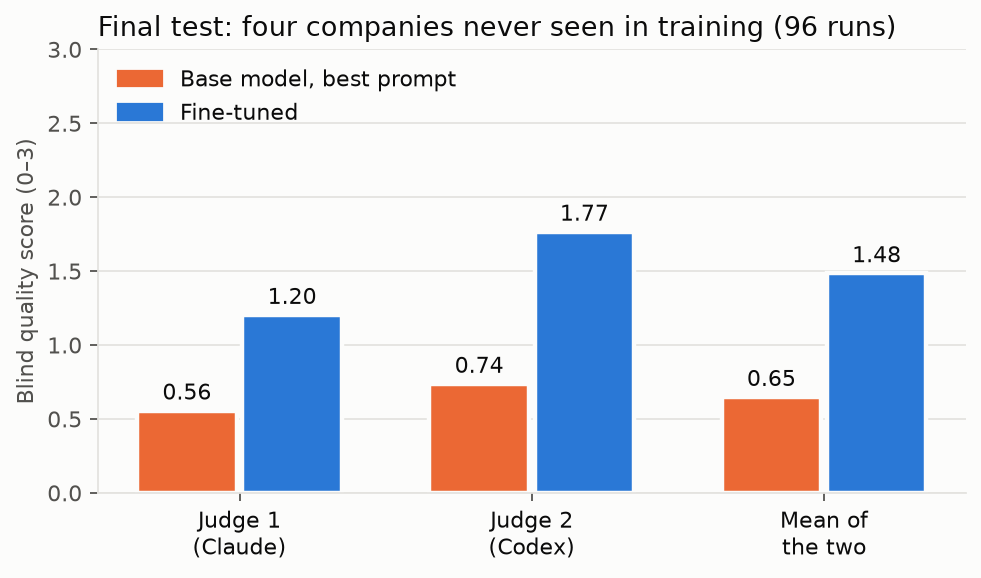
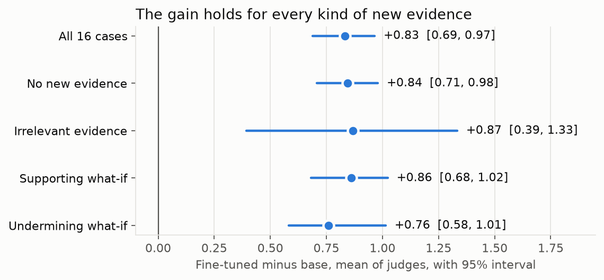
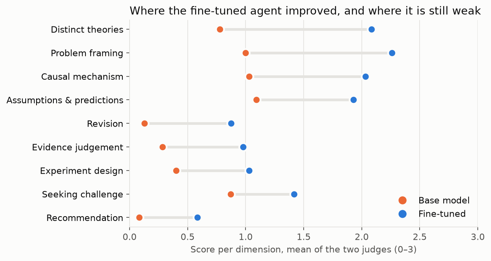

# Aemon: teaching a 3B model to investigate a strategy question, with AgentTune and AuditKIT

*weigh what is known. test what is not.*

**Team Two-eyed Ravens** · Lexsi AI Hackathon, Track 3 (Agentic Fine-Tuning) · November 2026

> **Result in one line.** On four companies it never saw, under the same investigation setup, the fine-tuned Tiny Aya
> agent scored **1.48** against the best-prompted base model's **0.65** on a 0–3 blind LLM rubric (mean of two judges;
> difference **+0.83, 95% interval 0.69 to 0.97**), and was higher at every company. Four companies support only a
> limited claim about generalisation, and nothing here is about business outcomes.

---

## 1. Problem and approach

Asked whether a manufacturer should take its technology into a new market, language models tend to produce
consulting prose: lists of factors, confident market sizes with no source, and evidence collected only for the answer
they started with. Strategy research describes a better habit (Camuffo, Cordova, Gambardella and Spina, 2020, *A Scientific
Approach to Entrepreneurial Decision Making*, Management Science; Camuffo, Gambardella and Pignataro, 2024,
*Theory-driven strategic management decisions*, Strategy Science): frame the decision and its real alternatives; state rival causal
theories of who would change their behaviour and why; derive predictions that tell the theories apart; look for
evidence against the favoured theory; design a test with a decision rule when information is worth its cost; and
revise when new evidence arrives.

**Track 3 problem statements addressed:** mainly *agentic distillation* (a stronger teacher's agent trajectories
distilled into a small local student), with *efficient trajectories* (fewer redundant, looping and failed calls) and
*workflow and decision agents* (a multi-step investigation with rules and a full audit trail).

**The question we test:** can agentic fine-tuning teach that procedure to a small model, beyond what a stage controller
and the best prompt already achieve?

**The framework behind the procedure.** Camuffo, Gambardella and Pignataro (2024, *Theory-driven strategic
management decisions*, Strategy Science 9(4): 382–396) formalise a theory as a restriction on beliefs. In their
Luxottica example, two uncertain attributes (can the firm design fashion eyewear, Y or N; will demand be high or low, H
or L) define four states, and the decision maker cares about P(H). A theory, "fashion design causes demand", is a
Bayesian network with one arrow plus an inequality on its conditional probabilities, θHY > θHN. Beliefs about the
unknown parameters form a distribution μ; the theory allows only parameters in a set Θ, the null hypothesis
(θHY = θHN) only Θ̃, and with prior ω on the theory its value is V = ω·VΘ + (1 − ω)·VΘ̃. With θHN = 0.5, θY = 0.8 and
θHY uniform, the theory restricts θHY to (0.5, 1), whose mean is 0.75, so the expected probability of high demand
rises from 0.5 to VΘ = 0.5 + 0.8 · (0.75 − 0.5) = 0.7:
a theory raises belief by ruling parameter values out. An experiment updates μ, and the prior on the theory itself
changes only when the evidence moves μ past a threshold, so a small surprise adjusts parameters and a large one shakes
the theory. A rival theory has its own value Q, and with costly experiments committing is right once V is far enough
above or below Q; in between it pays to experiment.

**How the agent carries this out.** The agent follows these steps in words, with tools and evidence; neither it nor
the harness computes a Bayesian update, because that would need an invented network and invented numbers, and assumed
ratios could create the very revision we want to measure. Instead, when it states its position and again after a
what-if result, the agent rates each theory on a five-point scale (very unlikely, unlikely, uncertain, likely, very
likely). The scale is a signal within one run, not a calibrated probability.

**The setup.**
- **An investigation environment** with twelve tools (`read_brief`, `frame_problem`, `search_evidence`, `read_source`,
  `add_theory`, `assess_evidence`, `challenge_theory`, `propose_test`, `decline_test`, `state_position`,
  `revise_theory`, `finish`) over a dossier of 1,334 public records. Quotes must match a source exactly; theories must
  give distinct causal explanations; a simulated what-if result may change beliefs but cannot support a recommendation
  about real demand. Refused calls return the reason.
- **A stage controller** that offers the tools of the current stage: brief, frame, read, theories, assessment,
  challenge, test, position, new evidence, conclusion.
- **A teacher**, Command A+ (Apache 2.0), run on a university cluster through the same tools. Every teacher
  investigation is replayed against the environment, and only investigations that replay exactly and reach an
  accepted finish become training data.
- **The student**, Tiny Aya Global, fine-tuned with AgentTune (LoRA) on the teacher's tool calls, then evaluated with
  AuditKIT, executable checks and two blind LLM judges.

## 2. Hackathon repositories used

**AgentTune** (`src/aemon/training/train.py`, `training/masking_gate.py`)
- `agenttune.agentic.distill_trainer.create_distill_trainer` builds the distillation trainer (TRL SFT with PEFT LoRA)
  from our rows; `agenttune.agentic.events` (`Event`, `EventLog`) records each investigation as an event log.
- Loss is computed only on the target tool call; the context is masked. A masking gate checks this on real rows before
  any training run.

**AuditKIT** (`src/aemon/evaluation/diagnostics/audit.py`)
- `AgentEvalRunner`, `AgentCase`, `AgentEvalSpec` and `episode_from_eventlog` run every evaluation episode through
  AuditKIT; a `CustomPredicate` replays the full event log through our environment and requires every tool result to
  reproduce.
- Diagnostic scorers on every run: `tool_call_validity`, `redundant_tool_calls`, `agent_loop_detection`,
  `tool_permission`. Every development and final report carries an `auditkit` block (0 replay mismatches throughout).

The two connect: the AgentTune event logs that produce training rows are the same logs AuditKIT replays.

## 3. Models and licences

| Model | Role | Version | Licence |
|---|---|---|---|
| Tiny Aya Global (CohereLabs) | student | `CohereLabs/tiny-aya-global`, revision af89d21; bf16 GGUF for evaluation | CC-BY-NC-4.0 |
| Command A+ (Cohere) | teacher | Q4_K_M GGUF (about 135 GB), weights sha256 recorded in every row | Apache 2.0 |
| Claude (Anthropic, `claude-opus-5-5`) | blind judge; earlier, a workflow control | API | proprietary; **no Claude output is ever training data** (provider terms), enforced by the provenance checks |
| Codex (OpenAI, `gpt-6-astra`, codex-cli 0.166.0) | blind judge | CLI, sandboxed, no repository access | proprietary; evaluation only |

## 4. Data, cases and licences

- **Dossier** (`data/dossier/evidence.json`): 1,334 public records (935 independent observations, such as standards,
  regulatory filings, studies and trade press; 399 company claims, kept apart so a theory cannot rest only on what a
  company says about itself). Each record keeps its URL, date and an excerpt. Records written after a decision date
  are flagged.
- **Cases**: 137 development cases on 64 companies, plus 16 held-out cases on 4 companies. Each case is a company and a
  question with search and test budgets, and some deliver a what-if result after the agent states a position
  (irrelevant, supporting or undermining). Every case declares in advance whether a test is worth its cost.
- **Splits by company**: 58 training companies, 6 validation companies (Hellberg, Neumann, Jotun, Tanita, Deere, ACR)
  for the development choices, and 4 final-test companies (Aquaporin, Electrolux Professional, RATIONAL, Simonelli),
  frozen by digest (`docs/final_test_freeze.json`, dce26d4f…) before any model ran on them.
- **Training data**: 174 accepted teacher investigations, giving 4,302 rows; training used the 3,891 rows from 158
  investigations on 57 training companies, plus 51 correction rows (a teacher showing a valid next step from a state
  where the student had looped). The 411 validation rows were kept out.
- **Rights**: excerpts are short quotations from public sources with attribution. Redistribution terms of the
  excerpts are checked source by source before the dossier is published.

## 5. Model artifacts

Collection: [Aemon: a strategy-investigation agent](https://huggingface.co/collections/HatemSaadallah/strategy-investigation-agent-6af0d2ab19339ae58d020326).
Model: [HatemSaadallah/tiny-aya-global-strategy-agent](https://huggingface.co/HatemSaadallah/tiny-aya-global-strategy-agent)
(a derivative of Tiny Aya, so CC-BY-NC-4.0):
- the LoRA adapter (`adapter_model.safetensors`, `adapter_config.json`; sha256 740c4a9b…);
- the converted GGUF adapter for llama.cpp (`tiny-aya-global-strategy-lora-bf16.gguf`, sha256 41794b57…), the exact
  file evaluated on the final test;
- the tokenizer, chat template and model card. Training and evaluation configurations and the job scripts are in the
  code repository.

## 6. Data artifacts

Dataset: [HatemSaadallah/strategy-agent-investigations](https://huggingface.co/datasets/HatemSaadallah/strategy-agent-investigations)
(in the same collection), with every third-party excerpt cut to one short quote:
- the training rows and correction rows, each bound to its teacher episode and weights hash;
- the 153 development cases, the 16 final-test cases and the dossier of 1,334 records;
- evaluation transcripts for development and the final test, the blinded judge packets, both judges' outputs, the
  answer key, and every report;
- `MANIFEST.json`, with the sha256 of each private original and of its published copy.

## 7. Experiments and findings

### Early development (small runs, diagnostic only)
- **The untrained model cannot do the task.** In an open workflow it quit after a step or two; under the stage
  controller it stalled, mostly by repeating a theory or search it had already made.
- **Full chat histories did not fit.** Late-stage rows exceeded 8,192 tokens and were refused rather than truncated, so
  most conclusion rows were lost. We replaced the history with a compact state (theories, quotes, tests and revisions in
  full, everything else summarised), which kept every row.
- **Loops at temperature 0.** The first fine-tuned runs went much deeper but repeated refused calls. We added
  correction rows and made the state say plainly that rereading a source returns the same text.
- **A better teacher.** Aya Expanse 32B followed the workflow but reasoned weakly and was rejected as a teacher;
  Command A+ replaced it.

### Controls that the result rests on
- **Conversion check.** Every evaluated adapter was converted to GGUF and replayed against the PEFT adapter on the GPU:
  effect cosine at least 0.99 and probability-weighted residual at most 0.15 on every point, plus a weight-file audit.
  The final adapter passed (cosine 0.9990, residual 0.080), and the evaluated file is byte-identical to the gated one.
- **Judges.** Each judge first scored 20 matched pairs of investigations, sound and flawed, and had to rank the sound
  one higher in at least 17. Claude did so in 20 of 20 (after its output limit was raised and it was requalified),
  Codex in 20 of 20. Packets carry no model name; the key stays outside the judges' reach.

### Development (6 validation companies, 15 cases, one attempt each)

| Arm | Finished | Quality, mean of two judges |
|---|---|---|
| Base, compact prompt | 0 of 15 | 0.14 |
| Base, staged prompt | 0 of 15 | 0.43 |
| Earlier adapter | 6 of 15 | 1.09 |
| **Final adapter** | 7 of 15 | **1.29** |

By the preregistered rule (higher mean judge score) the staged prompt became the base and the final adapter the
trained arm. The two adapters were not distinguishable (+0.20, interval −0.09 to 0.53).

### Final test (4 held-out companies, 16 cases, 3 attempts, 96 runs, run once)

| | Base, staged prompt | Fine-tuned | Difference, paired, 95% case-cluster bootstrap |
|---|---|---|---|
| Claude | 0.56 | 1.20 | +0.64 [0.51, 0.77] |
| Codex | 0.74 | 1.77 | +1.03 [0.87, 1.18] |
| **Mean of judges** | **0.65** | **1.48** | **+0.83 [0.69, 0.97]** |
| Finished investigations | 4 of 48 | 28 of 48 | |

- Every company is higher under both judges (mean of judges: Aquaporin +1.10, Simonelli +0.98, RATIONAL +0.66,
  Electrolux Professional +0.60), and every kind of new evidence (no new evidence +0.84, irrelevant +0.87, supporting
  +0.86, undermining +0.76).
- The judges agree on the ordering (Spearman 0.94 over 95 runs scored by both).
- The largest gains are in distinct theories, framing, causal mechanism and revising on new evidence; the weakest
  dimensions for the trained agent remain the recommendation, revision, experiment design and judging evidence.

**How each run ended** (48 runs per arm; a run is refused a call when it breaks a rule, and stops after repeated
refusals, at the context limit or at the turn limit):

| | Base, staged prompt | Fine-tuned |
|---|---|---|
| Finished with an accepted recommendation | 4 | 28 |
| Stopped after repeated refused calls | 19 | 11 |
| Stopped at the context limit | 25 | 0 |
| Stopped at the turn limit (45) | 0 | 9 |
| Mean calls per run | 20.2 | 35.4 |
| Refused calls, all runs | 279 | 242 |

**Do beliefs move the right way when a what-if arrives?** In the 36 runs per arm whose case delivers a simulated
what-if result, the base model reached it in 11 and the fine-tuned model in 28. A direction check compares the
affected theory's five-point belief before and after: undermining evidence should not raise it, supporting evidence
should not lower it. Of the fine-tuned runs where both beliefs were stated, 6 of 6 moved in the allowed direction (3
undermining, 3 supporting), and in 2 a belief was missing before or after; none moved the wrong way. The base model
stated no before-and-after pair. This is a direction check only, not a quality score: a weak result may rationally
change nothing, and the blind judges score revision as part of the rubric.

### Cost: the fine-tuned agent against a closed model (`reports/cost/roi.json`)

Measured on the final test, one investigation by the fine-tuned agent reads about 121,700 prompt tokens and writes about
2,900 over 35 tool calls, in **66 seconds on one A100 slice**, one investigation at a time: about 54 an hour.

| | per investigation | per 10,000 investigations |
|---|---|---|
| **Fine-tuned Tiny Aya, self-hosted** (A100 40 GB, Oct 2026 median $1.76/h; range $0.89-$3.67) | **$0.032** ($0.016-$0.068) | **$324** (184 GPU hours; $164-$676) |
| Claude Opus 5.5, measured on our earlier control run (15 investigations, $3.73) | $0.25 | $2,483 |
| Claude Opus 5.5, the same token volume at list price, no caching ($4 / $20 per million) | $0.54 | $5,442 |
| Claude Sonnet 5.5, the same token volume ($2 / $10) | $0.27 | $2,721 |
| Claude Haiku 5.5, the same token volume ($0.10 / $0.50) | $0.014 | $136 |

- Self-hosting costs about **8 times less than the measured Opus run** and 8 to 17 times less than Sonnet or Opus at
  the same token volume. Per finished investigation (28 of 48) it is about $0.056.
- **Haiku 5.5 at list price is cheaper than renting a GPU for this agent**, and we did not measure its quality on this
  task; the case for self-hosting against it rests on running offline and keeping the case data local, not on price.
- The closed models are not quality-matched: Claude finished all 15 control investigations on the earlier harness,
  against the fine-tuned agent's 28 of 48 here.
- The teacher shows the other side of distillation: Command A+ took about 2 hours 10 minutes per batch of four on the
  same kind of slice (about 1.8 investigations an hour), so the student runs roughly **30 times faster** per GPU.
- Not measured: running several investigations at once on one GPU, which llama.cpp supports and would lower the
  self-hosted cost further.

Prices: Anthropic list prices as of October 2026; GPU prices from aggregator snapshots (amcompute.com, October 2026;
gpu-cost.pages.dev, June 2026), which change often.

### What still fails, and why (`docs/FINAL_TEST_DIAGNOSIS.md`)
Only 1 of 48 trained runs passes every mechanical check (all-checks success was also rare in the teacher's training
data, 1 of 223, on other cases), and 20 of 48 stop before a recommendation. One check is itself flawed: five of six predictions-overlap
failures involved contrasting predictions that the checker incorrectly treated as identical. This does not establish
that the experiments were otherwise sound. The frozen numbers are reported as computed. Several failures trace to behaviour the
training data never showed:
- **Never declining a test.** No training example declines one. The labels need care: for Aquaporin, declining
  follows from its insolvency and bankruptcy, recorded in the dossier, yet **no run of either arm found those records**
  and every finished trained run recommends investing. For RATIONAL the no-test label is the case author's judgement
  and is contestable.
- **Little what-if evidence that matters.** Only 8 of 205 teacher investigations had supporting or undermining
  results; the student handles irrelevant evidence correctly and revises the wrong theory on Aquaporin's pair.
- **Simulated-only finishes.** Eight runs try to finish citing only the simulated result, are refused, and repeat until
  the error limit.
- **Rereading.** Nine runs reach the turn limit; in eight of them the agent rereads the same few sources.

### Second frozen test (12 new companies, 24 cases, 3 attempts, 144 runs, run once; `docs/test2_freeze.json`)
A second test on companies never used for training, development or the diagnosis above. It was frozen before any run,
under the same judges, rubric and rule.

| | Base, staged prompt | Fine-tuned | Difference, paired, 95% case-cluster bootstrap |
|---|---|---|---|
| Claude | 0.48 | 0.89 | +0.41 [0.24, 0.57] |
| Codex | 0.66 | 1.29 | +0.63 [0.43, 0.84] |
| **Mean of the two judges** | **0.57** | **1.09** | **+0.52 [0.33, 0.70]** |
| Finished investigations | 2 of 72 | 32 of 72 | |
| Finished and passing every check | 1 | 4 | |

- The fine-tuned agent is higher for 10 of 12 companies on the mean of judges. Franke Coffee (−0.05) and Hoshizaki
  (−0.10) are slightly lower.
- The gain is smaller than on the first test (+0.83 there on the mean of judges). The two judges rank the runs alike
  (Spearman 0.95 over all 144).
- The weakest dimensions are the same as before: the recommendation (0.03 → 0.44), experiment design (0.22 → 0.50) and
  judging evidence (0.28 → 0.39).

### A recovery controller does not fix the remaining failures (`docs/RECOVERY_REPORT.md`)
We tested five controller-side recovery aids, on development cases only and with a pre-registered selection rule:
- masking rereads;
- progress notes;
- step-budget awareness;
- citation repair;
- all four together.

| | Recovery of stuck runs (28 checkpoints) | Full runs: finished (of 45) | Full runs: every check passed | Blind quality |
|---|---|---|---|---|
| As evaluated | 6 | 24 | 3 | 1.047 |
| Step-budget awareness (selected) | 15 | 25 | 3 | 1.053 (+0.006 [−0.017, 0.031]) |

The budget aid rescues stuck runs: 9 better, 0 worse. But most of those extra finishes fail a check, because they rush
a templated test and carry its numbers into the claims. End to end it changes 8 of 45 runs and leaves quality
unchanged. Most failed runs stop earlier, after four refusals in a row, where no late-stage aid acts. It is in the
Aemon as an opt-in, labelled option. More finishes are not better investigations; the remaining failures need
training, not a controller.

### Limits of our own checks
- **The mechanical experiment check is too lenient.** It accepts a test whose predictions differ and whose rule has a
  threshold. On development, 8 of the 9 tests it accepts fail stricter design screens:
  - 4 vary only the message;
  - 3 go straight to building a product line;
  - 1 is priced in euros in a 1993 case.

  The frozen numbers above use the original check. Later comparisons also report the stricter `experiment_v2`, which
  is development only.
- **Evidence-kind labels are about 80% reliable.** A blind relabelling of 60 training records agreed with the
  dossier's label on 45, and 5 more were defensible either way. It also found 3 likely errors, and 44 records with a
  kind the tool cannot express. The frozen labels are unchanged. A guide and a proposed overlay are in
  `docs/EVIDENCE_KIND_GUIDE.md`.

### What else we tested
Specialist adapters per stage (proposed; the data per stage was too thin), a Socratic coach (proposed, not built), more teacher data
versus the clearer state (inconclusive), and scripted always-keep and always-revise policies as negative controls on
the development cases (they could not run on the held-out cases, which we report as a deviation).

### Lessons
- The controller, the guards and replay made the teacher's data trustworthy, and the same machinery made every
  evaluation run auditable.
- Measuring with two qualified blind judges, a frozen plan and a one-shot test kept us from reading noise: several
  development differences that looked real were not.
- Most remaining failures are gaps in the training data, not in the amount of it.

## 8. With more credits

The diagnosis gives a concrete plan, each part confirmed on development cases before new training examples are chosen,
and measured on fresh evaluation cases, since the four final-test companies have now informed the diagnosis:
1. Justified propose-versus-decline examples, where the decision follows from explicit constraints and the value of
   the information, allowing either decision when warranted.
2. Balanced supporting and contradicting what-if evidence, explicitly linked to the theory it bears on.
3. Recovery from simulated-only citations, separating a hypothetical belief update from the real evidence behind a
   recommendation.
4. Recovery from rereading, using the information already gathered.
5. Searching for the company's current position before theorising (the Aquaporin failure).

More teacher runs of the same kind would not address these gaps; more of these specific cases would. Before and after
would be measured exactly as here: the same frozen judges and rule, on new held-out companies.

**What we tried after the tests, and what it showed (10 November; `docs/RELIABILITY_REPORT.md`).**
- **Corrective distillation.** We built teacher examples at states where version 1 itself went wrong: invented numbers,
  experiment design, evidence kind, and recovery after refusals.
  - Each was checked for provenance, exact replay and split, then reviewed against substantive criteria.
  - Of 90 examples the mechanical checks accepted, an advisory review rated 3 strong, and spot checks confirmed its
    reasons.
  - The teacher (Command A+) makes the same errors it was meant to correct: it calls encyclopedia and news text
    "independent study", relies on sources published after the case date, and designs tests that vary only the message.
  - A structured format fixed its truncated test designs, but then it declined tests the cases warrant.
  - We had fixed a threshold of 30 strong examples, including experiment design, before training. It was not met, so
    no version 2 was trained.
- **Auditing version 1's own data.** The same weaknesses are in the teacher data version 1 was trained on:
  - 74% of the teacher's recommendations use a number from no source;
  - 38% of its evidence kinds match the annotation;
  - 47% of its recommendations in historical cases cite a source published after the case date, and about half of those
    quotes reveal later outcomes.

  The frozen tests are present-day cases, so their scores are unaffected.
- **An evidence-verification layer, without retraining.** Before the final recommendation, the agent was shown what its
  evidence did not support, and could revise or answer "insufficient evidence". On 45 paired development runs this gave
  19 unsupported recommendations against 20, the same validated completion, and no abstention. The 3B model rewrote the
  text but not the evidence behind it. Aemon shows these findings to the reader instead.
- **Two more runtime attempts, both rejected under rules fixed in advance.**
  - Constraining the favoured theory to those the agent's own weighings support collided with an existing guard and
    halved the finishes.
  - Novelty-first search doubled the sources the agent was shown, but it weighed fewer of them, found contradicting
    evidence in the same 2 of 45 runs, and finished with every check cleared in 0 runs against 3.

The lesson for distillation: a teacher's errors pass to the student, and they cannot be filtered out afterwards. A
stronger or human-corrected teacher for evidence judgement is the next step, not more of the same data.

## 9. Team

Team Two-eyed Ravens: Hatem Saadallah and Nour Jennane, Master's students in artificial intelligence and AI
researchers.

Built with AgentTune and AuditKIT (Lexsi Labs), Tiny Aya and Command A+ (Cohere), PEFT, TRL and llama.cpp, on the
Bocconi University HPC cluster. Claude (Anthropic) and Codex (OpenAI) served as blind judges and as coding assistants.
