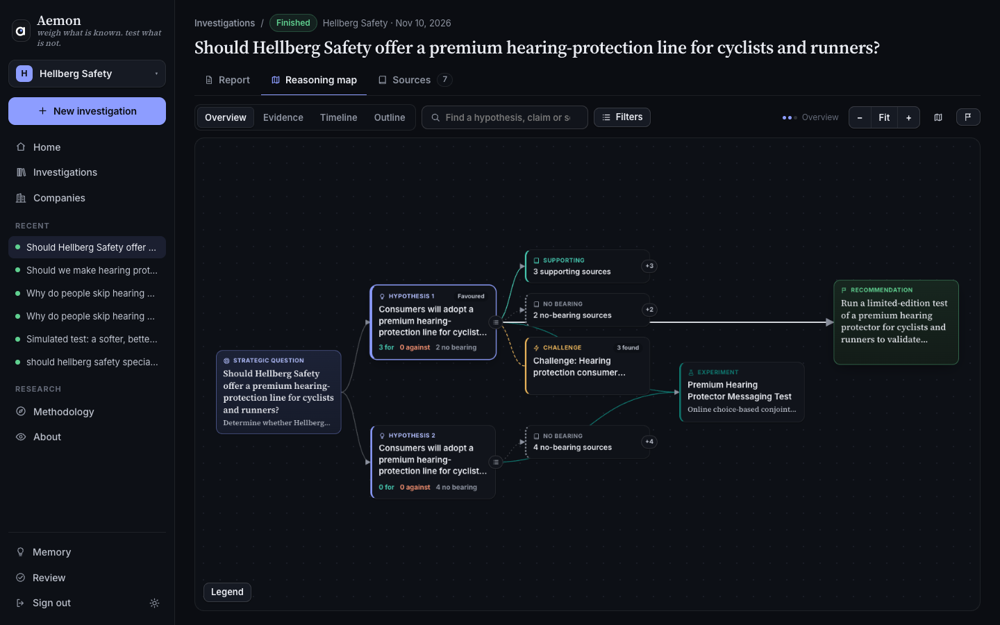
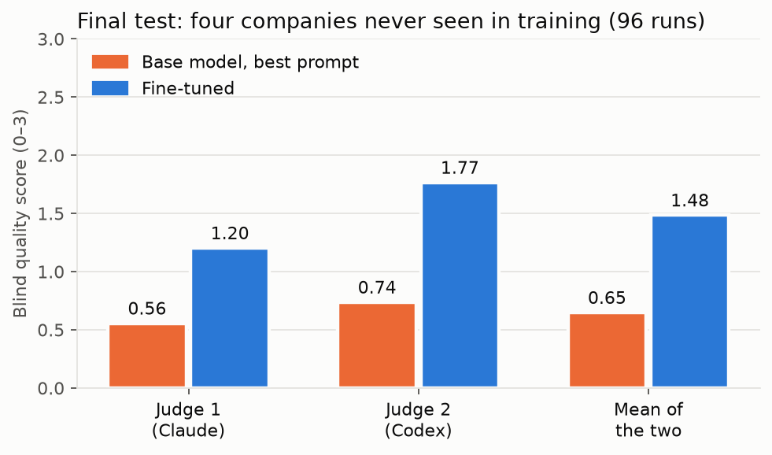
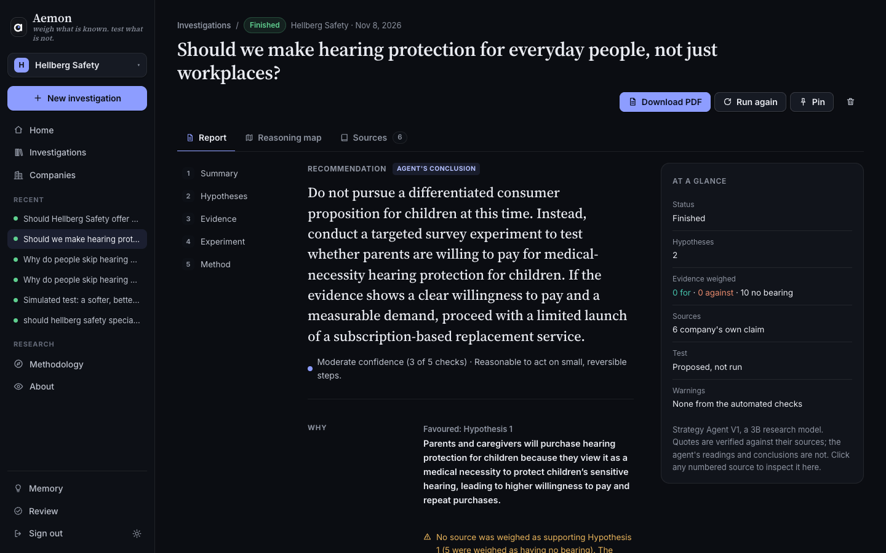

*Code, every run and every decision: [github.com/HatemSaadallah/aemon](https://github.com/HatemSaadallah/aemon) · Try it: [the live demo](https://huggingface.co/spaces/HatemSaadallah/aemon) (any username, no password) · Watch it: [demo video](https://youtu.be/Uow3miSSIIY) · Model and data: [the Two-Eyed Ravens collection](https://huggingface.co/collections/two-eyed-ravens/aemon-a-strategy-investigation-agent-6af71da6a81fe397ad0b38dd) · [Paper](https://github.com/HatemSaadallah/aemon/blob/main/docs/PAPER.pdf)*

*weigh what is known. test what is not.*

Team Two-Eyed Ravens · Lexsi AI Hackathon, Track 3 (Agentic Fine-Tuning) · November 2026

**One-line claim.** Agentic distillation with AgentTune takes a 3B open model from unable to finish a strategy investigation to **+0.83** blind quality over its best-prompted self on a frozen test run once, with every step replayable through AuditKIT; a closed model still does better, and we say by how much.

**Tracks and problem statements covered**

- Track 3, Agentic Fine-Tuning, problem statement 3: **Agentic distillation**.
- Track 3, problem statement 7: **Business workflow and decision agents**.
- Problem statement 2, Efficient trajectories, is measured (39 tool calls per finished investigation against the base model's 242) but was a result, not a goal.

**Headline, before → after.** Blind quality **0.65 → 1.48** (0–3 rubric, mean of two blind judges; +0.83, 95% interval 0.69 to 0.97) and finished investigations **4 → 28 of 48**, on four companies never seen, run once. The final system, built afterwards, on the same cases: **0.61 → 1.62** and **4 → 46 of 48**.

**Base model and method, in one line.** Tiny Aya Global (3.35B, CC-BY-NC-4.0), LoRA rank 16 on every linear layer, trained with AgentTune's distillation trainer on 158 Command A+ investigations that replayed exactly in our tool environment, then evaluated by AuditKIT replay, executable checks and two blind LLM judges.

### Abstract

Should a manufacturer take its technology into a new market? The answer could shape its next product, investment, and years of work. Aemon helps teams investigate that decision before they commit.

Aemon is a strategy investigation agent powered by a small, locally runnable language model. Give it a market-entry question, and it builds competing explanations, searches for evidence, challenges its favourite hypothesis, and proposes a practical test. The investigation unfolds in an interactive workspace where users can explore the reasoning, inspect sources, and see what would change the recommendation.

At its core is a simple principle: make the reasoning inspectable. Twelve guarded tools structure the investigation, check quotations against their sources, and prevent simulated results from being presented as real evidence. Every tool call is recorded and can be replayed.

We used AgentTune to distill successful investigations from a stronger teacher into Tiny Aya Global, a 3.35-billion-parameter model, and AuditKIT to replay evaluation runs. On two frozen tests covering 16 unseen companies, the fine-tuned model outperformed its best-prompted base under two blind LLM judges. On the first test, its average quality score rose from 0.65 to 1.48 out of 3.

We then tackled the failures directly. Two complementary adapters divide evidence gathering and reasoning, while decoding constraints prevent repeated actions and invalid quotations. This final system completed 46 of 48 investigations, compared with 4 of 48 for the base model on the same benchmark. These later results reflect improvements developed after the original tests.

Aemon can run locally on a laptop or GPU, giving teams control over their model and keeping case data on their own machine. Recommendations still need human review; the strongest gains are in structuring the investigation.

Our goal is to help teams move from "we think this will work" to "here is the evidence, here is the uncertainty, and here is what we should test next."

> **For judges: one minute.**
> - **What:** a 3B open model taught, by distillation from Command A+ with AgentTune, to run a strategy investigation through twelve guarded tools, with AuditKIT replaying every evaluated run.
> - **Result:** blind quality 0.65 → 1.48 (+0.83 [0.69, 0.97]) on a frozen test run once; +0.52 [0.33, 0.70] on a second; the final system reaches 1.62 and finishes 46 of 48 investigations in 39 tool calls each (base model: 4 of 48, 242 calls).
> - **The caveat we state ourselves:** Claude Haiku 5.5 scores 2.28 through the same tools for a quarter of the cost. The small model's case is offline, open-weights, auditable use.
> - **See it in 60 seconds:** [one finished run as a page](https://github.com/HatemSaadallah/aemon/blob/main/docs/replays/system_rational-new-evidence-irrelevant_2.md), every tool call and refusal included; or [the live demo](https://huggingface.co/spaces/HatemSaadallah/aemon), any username, where finished investigations open at once.
> - **Everything public:** [model](https://huggingface.co/two-eyed-ravens/aemon), [dataset with every judged run](https://huggingface.co/datasets/two-eyed-ravens/aemon), [code and dated decisions](https://github.com/HatemSaadallah/aemon), [paper](https://github.com/HatemSaadallah/aemon/blob/main/docs/PAPER.pdf), [demo video](https://youtu.be/Uow3miSSIIY).

## 1. Problem and approach

Ask a language model whether a maker of professional espresso machines should sell one for the home, and you get consulting prose: a list of factors, a confident market size with no source, and evidence collected only for the answer it started with. Strategy research describes a better habit (Camuffo, Cordova, Gambardella and Spina, 2020, *Management Science*; Camuffo, Gambardella and Pignataro, 2024, *Strategy Science*). Frame the decision and its real alternatives. State rival causal theories of who would change their behaviour and why. Look for the evidence that would prove your favourite wrong. Run a test with a decision rule when the information is worth its cost. Revise when new evidence arrives.

We wanted to know whether a 3B open model could be taught that habit as an agent, with the Lexsi tools, and whether the result would be worth running. So we built an environment in which the habit is the only way through. **aemon** has twelve guarded tools over a dossier of public records (`read_brief`, `frame_problem`, `search_evidence`, `read_source`, `add_theory`, `assess_evidence`, `challenge_theory`, `propose_test`, `decline_test`, `state_position`, `revise_theory`, `finish`), and a stage controller that offers the tools of the current stage. The environment refuses what a careless analyst would do: a quote that is not word for word in its source, two theories that are one explanation in different words, a recommendation resting on a simulated what-if result instead of real evidence. Every refusal returns its reason, and every call can be replayed.

A stronger teacher, Command A+, ran investigations through those tools. Only the investigations that replayed exactly and reached an accepted finish became training data. We distilled them into a LoRA adapter on Tiny Aya Global with AgentTune, replayed every evaluation run with AuditKIT, and scored runs with executable checks and two blind LLM judges.

**The question we test:** can agentic fine-tuning teach the procedure to a small model, beyond what the stage controller and the best prompt already give the base model?

**The answer, in one line.** On four companies it never saw, run once, the fine-tuned model scored **1.48 against 0.65** for the base model under its best prompt on a 0–3 blind rubric (**+0.83**, 95% interval 0.69 to 0.97), was higher at every company, and finished 28 of 48 investigations against 4. A second frozen test on twelve more companies gave **+0.52** [0.33, 0.70]. The final system, built after both tests, finishes **46 of 48** investigations with **39 tool calls** each, where the base model needs 242. A closed model, Claude Haiku 5.5, still does better through the same tools, and for less; section 7 says by how much, and what aemon offers instead.

**Track 3 problem statements:** 3, agentic distillation, and 7, business workflow and decision agents. Efficient trajectories (2) came out of it as a measured result rather than a goal.

**Why this problem, and who would use it.** Adjacent-market decisions of this kind are made every year by mid-sized manufacturers that have no strategy department: whether a maker of professional kitchen equipment, water filters or hearing protection should sell to consumers. The people who make them are the owner, a product lead and a consultant's slide deck. An investigation that cites only checked quotes, shows what the evidence does not support, and can be replayed is useful to them exactly because the recommendation can be argued with. It also has to run on their own machine, since the dossier for a real decision is often confidential; that is why the student is a 3B model and not an API call.

## 2. Hackathon repositories used

Three Lexsi repositories, connected: AgentTune trains on rows built from teacher runs that replay exactly in our environment; every evaluated run is converted to AgentTune's event-log format and replayed by AuditKIT against the same environment; CuratorKIT filters the rows.

- **AgentTune** (`src/aemon/training/train.py`, `training/masking_gate.py`). `agenttune.agentic.distill_trainer.create_distill_trainer` builds the distillation trainer (TRL SFT with PEFT LoRA) from our rows, and `agenttune.agentic.events` (`Event`, `EventLog`) is the format every evaluated run is converted to. Loss is computed on the target tool call only, with the context masked; a masking gate checks that on real rows before any training run.
- **AuditKIT** (`src/aemon/evaluation/diagnostics/audit.py`). `AgentEvalRunner`, `AgentCase`, `AgentEvalSpec` and `episode_from_eventlog` run every evaluation episode; a `CustomPredicate` replays the full event log through our environment and requires every tool result to reproduce. Four diagnostic scorers run on every run (`tool_call_validity`, `redundant_tool_calls`, `agent_loop_detection`, `tool_permission`). All 22 run reports show 0 replay mismatches.
- **CuratorKIT** (`src/aemon/rows/curate.py`). Decides which training rows to keep and never rewrites one: exact deduplication on (state, target call) and a secrets gate, with its own run record. On version 1's rows it keeps 3,958 of 4,302; all 344 dropped rows are exact duplicates. It was added after the evaluated adapters were trained, for the next training run, so no result below depends on it.

## 3. Models and licences

| Model | Role | Version | Licence |
|---|---|---|---|
| Tiny Aya Global (CohereLabs) | student | `CohereLabs/tiny-aya-global`, revision af89d21; bf16 GGUF for evaluation | CC-BY-NC-4.0 (so are our adapters) |
| Command A+ (Cohere) | teacher | Q4_K_M GGUF (about 135 GB); weights sha256 recorded in every row | Apache 2.0 |
| DeepSeek V4-Pro (`deepseek-v4-pro`) | second teacher, for version 3 (the final system's reasoner) | hosted API | proprietary; its investigations pass the same replay checks |
| Claude (Anthropic, `claude-opus-5-5`) | blind judge; earlier, a workflow control | API | proprietary; **no Claude output is ever training data** (provider terms), enforced by the provenance checks |
| Codex (OpenAI, `gpt-6-astra`, codex-cli 0.166.0) | blind judge | CLI, sandboxed, no repository access | proprietary; evaluation only |
| Claude Code (`claude-opus-5-5`) and Codex (`gpt-6-sol`) | blind judges for the final system's comparisons | CLI, no tools, no repository access | proprietary; evaluation only; each qualified separately (19 of 20 and 20 of 20) |
| Claude Haiku 5.5 (`claude-haiku-5-5`) | closed-model baseline on both test sets | API, effort medium, the same environment and limits as every arm | proprietary; evaluation only; never training data |

Why these models: Tiny Aya Global is the Cohere model small enough to run an investigation on a laptop, which is the point of the project. Command A+ was the strongest open-weights teacher we could run locally through our own tools (Aya Expanse 32B followed the workflow but reasoned weakly, and was rejected as a teacher). The judges are two different vendors' models, so that neither judges its own family.

## 4. Datasets and benchmarks, with licences

No benchmark existed for this task, so the data is ours, and all of it is published.

- **Dossier** (`data/dossier/evidence.json`): public records, each with its URL, date and an excerpt. Version 1 was trained and first tested on 1,334 of them: 935 independent observations (standards, regulatory filings, studies, trade press) and 399 company claims, kept apart so a theory cannot rest only on what a company says about itself. With the second test's companies and the later training cases it now holds 1,958 (1,246 and 712). Records written after a decision date are flagged. Excerpts are short quotations (median 24 words, at most 100), each with its publisher and link.
- **Cases**: a company, a question, search and test budgets, and sometimes a what-if result delivered after the agent states a position (irrelevant, supporting or undermining). Every case declares in advance whether a test is worth its cost. 137 development cases on 64 companies when version 1 was trained (207 on 99 companies now), 16 held-out cases on 4 companies, and a second test of 24 cases on 12 companies.
- **Splits by company**, never by case: 58 training companies, 6 validation companies for every development choice (Hellberg, Neumann, Jotun, Tanita, Deere, ACR), 4 final-test companies (Aquaporin, Electrolux Professional, RATIONAL, Simonelli) frozen by digest before any model ran on them, and the second test's 12, frozen the same way.
- **Training data**: 174 accepted teacher investigations gave 4,302 rows. Training used the 3,891 rows from 158 investigations on 57 training companies, plus 51 correction rows (the teacher showing a valid next step from a state where the student had looped); the 411 rows on validation companies were held out, and the published dataset keeps them as a separate `validation` split. Version 3 added 3,611 rows from 144 DeepSeek V4-Pro investigations on 69 companies (262 validation rows on 5 more).
- **Rights**: the dossier quotes public sources with attribution, and is published in full so anyone can rerun what the evaluated runs read. The rows derive from Command A+ (Apache 2.0) and DeepSeek V4-Pro outputs; nothing from Claude or Codex is in them.
- **Languages**: English only. Every case, prompt, training row and dossier excerpt is in English; the companies are European, American and Japanese, but their records were taken from English-language sources.
- **Leak check**: splits are by company, never by case or row, because the rows of one investigation are near copies of each other and a row split would leak. The row builder takes only investigations on training companies (`src/aemon/data/splits.py`), so no row from a validation or test company can be in the training data; the test companies' cases were frozen by digest before any model ran on them. The dossier is shared across splits, since it is the environment the agent searches, not an answer key. We ran no embedding or MinHash check: company identity is recorded on every row, so the exact check is the complete one here.
- **Tool and task environment, trajectories**: the environment is the twelve guarded tools and the stage controller described in section 1, over the dossier and the cases above. A trajectory is the event log of one investigation (every call, argument, result and refusal), in AgentTune's event format, replayable with AuditKIT. Every trajectory we evaluated is published in the dataset's evaluation folders with its judge packet and judgments, and the two frozen tests are also readable as pages in the repository.
- **General-capability retention**: none was measured. The adapter is used only inside this environment through the app, and we list the missing retention check among the known weaknesses in section 7.

## 5. Model artifacts

Collection: [aemon: a strategy-investigation agent](https://huggingface.co/collections/two-eyed-ravens/aemon-a-strategy-investigation-agent-6af71da6a81fe397ad0b38dd). Model: [two-eyed-ravens/aemon](https://huggingface.co/two-eyed-ravens/aemon) (derivatives of Tiny Aya, so CC-BY-NC-4.0), with a table at the top saying which file is which:

- **Version 1, the evaluated adapter**: the LoRA (`adapter_model.safetensors`, `adapter_config.json`; sha256 740c4a9b…) and its GGUF conversion for llama.cpp (`tiny-aya-global-strategy-lora-bf16.gguf`, sha256 41794b57…), the exact file evaluated on the frozen tests.
- **Version 3, the final system's reasoner** (`v3_adapter.gguf`, sha256 ea919380…): continued from version 1 on the second teacher's rows. The app loads both; `app/server.py` sets the decoding-time guards.
- The tokenizer, chat template and model card. Training and evaluation configurations and the job scripts are in the code repository.

## 6. Data artifacts

Dataset: [two-eyed-ravens/aemon](https://huggingface.co/datasets/two-eyed-ravens/aemon), in the same collection:

- the training rows, loadable as splits: version 1's 3,891 train and 411 validation rows, the 51 correction rows, and the second teacher's 3,611 train and 262 validation rows, each bound to its teacher episode;
- the dossier in full (1,958 records, byte-identical to the one in the repository) and every case, with both freeze files;
- the second teacher's investigations (transcripts, provenance, request logs);
- every evaluation campaign: runs, blinded judge packets, judge outputs and reports, for development, both frozen tests, version 3, adapter switching, the combined system, the loop guards, evidence first, and the Claude Haiku 5.5 baseline;
- `MANIFEST.json`, with the sha256 of each private original and of its published copy.

The repository adds every test run as a readable page ([first test](https://github.com/HatemSaadallah/aemon/blob/main/docs/replays/final/README.md), [second test](https://github.com/HatemSaadallah/aemon/blob/main/docs/replays/test2/README.md)): every tool call, what the environment refused and why, and the judges' scores, with no GPU needed.

## 7. Experiments and findings

**The metrics, and why.** Every arm is measured the same way, before and after. **Finished investigations**: did the run reach an accepted recommendation? That is the reliability of the workflow. **Tool calls per finished investigation, and the share of calls refused**: wasted actions, since a refused call is a broken rule. **Blind quality** on a nine-dimension 0–3 rubric from two qualified LLM judges: whether the investigation is any good, the only measure that tells a finished run from a sound one. And **cost per investigation**, self-hosted against closed-model billing: the ROI comparison. Each judge first scored 20 matched pairs of investigations, sound and flawed, and had to rank the sound one higher in at least 17; packets carry no model name, and the key stays outside the judges' reach.

The metrics, with their direction:

- **Blind quality**, 0–3, mean of two judges over nine rubric dimensions ([the rubric](https://github.com/HatemSaadallah/aemon/blob/main/docs/RUBRIC.md)): higher is better. The primary result is the paired difference between arms with a 95% case-cluster bootstrap interval.
- **Finished investigations**, the task success rate (an accepted recommendation reached): higher is better.
- **Tool calls per finished investigation**, refused calls included: lower is better. **Share of calls refused**, the tool-call accuracy inverted: lower is better.
- **Replay mismatches** under AuditKIT, a run whose tool results do not reproduce: must be zero, and is, in all 22 run reports.
- **Latency and cost per investigation**: lower is better; 66 seconds and about $0.03 for version 1 on one A100 slice.
- **Checking the judges**: each judge ranked the sound investigation above the flawed one in 19 of 20 and 20 of 20 matched pairs; the two judges agree on the order of runs (Spearman 0.94 on the first test). No human has scored a run, which is the first limit listed below.

### Getting to a first result

The untrained model could not do the task at all: in an open workflow it quit after a step or two, and under the stage controller it stalled, mostly by repeating a theory or a search it had already made. Four small discoveries got us to a first adapter. Full chat histories did not fit: late-stage rows exceeded 8,192 tokens and were refused rather than truncated, so most conclusion rows were lost, until we replaced the history with a compact state (theories, quotes, tests and revisions in full, everything else summarised). The first fine-tuned runs went much deeper but looped on refused calls at temperature 0, so we added correction rows and made the state say plainly that rereading a source returns the same text. And every adapter was converted to GGUF and replayed against the PEFT adapter on the GPU before it was evaluated (effect cosine at least 0.99, probability-weighted residual at most 0.15; the final adapter passed at 0.9990 and 0.080), because an adapter that is not the one you trained is not a result.

On the six validation companies the base model finished 0 of 15 investigations under either prompt (quality 0.14 and 0.43), an earlier adapter 6 of 15 (1.09), and the final adapter 7 of 15 (1.29). By the preregistered rule the staged prompt became the base arm and the final adapter the trained arm, and we froze the test.

### Training setup and hyperparameters

Version 1 was trained with `src/aemon/training/train.py`, which calls AgentTune's `create_distill_trainer` (TRL SFT with PEFT LoRA) on the rows and leaves every AgentTune default in place except the values below. One A100, bfloat16, seed 7.

| | |
|---|---|
| LoRA | rank 16, alpha 32, dropout 0.05, every linear layer, `CAUSAL_LM` |
| Optimiser and schedule | AdamW, learning rate 1e-4, linear warm-up over 5% of steps, cosine decay |
| Batch | 1 per device, gradient accumulation 4 (effective 4) |
| Data and length | 3,942 rows (3,891 teacher rows and 51 correction rows), 2 epochs, 1,971 optimiser steps; rows over 8,192 tokens refused, never truncated |
| Loss | on the target tool call only; context tokens labelled −100, checked on real rows by the masking gate before the job starts |
| Checkpoint | lowest held-out loss on the six validation companies (the last checkpoint: 0.713, from 1.045) |
| Gates | an overfit run on 10 rows must reproduce at least 8 targets greedily; the GGUF conversion must match the PEFT adapter (cosine at least 0.99, residual at most 0.15 on every replayed point) |

Version 3 continued from version 1 on the second teacher's 3,611 rows with the same LoRA and seed, a lower learning rate (2.5e-5), one epoch and 10% warm-up (`jobs/train_v3.sbatch`). AuditKIT ran with its defaults plus our replay predicate and the four diagnostic scorers named in section 2; CuratorKIT ran with exact deduplication and the secrets gate. Evaluation decoding was greedy (temperature 0) for every arm, three attempts per case, which differ through the environment's state, so the attempts are repetitions rather than independent samples.

### The frozen test, run once

Four held-out companies, 16 cases, 3 attempts, 96 runs; the same environment, tools, stage controller and budgets for both arms.

| | Base, staged prompt | Fine-tuned | Difference, paired, 95% case-cluster bootstrap |
|---|---|---|---|
| Claude | 0.56 | 1.20 | +0.64 [0.51, 0.77] |
| Codex | 0.74 | 1.77 | +1.03 [0.87, 1.18] |
| **Mean of judges** | **0.65** | **1.48** | **+0.83 [0.69, 0.97]** |
| Finished investigations | 4 of 48 | 28 of 48 | |

Every company is higher under both judges (Aquaporin +1.10, Simonelli +0.98, RATIONAL +0.66, Electrolux Professional +0.60), and every kind of new evidence. Case by case, the fine-tuned agent scored higher on all 16 of 16 cases and in 44 of 47 paired runs (exact sign test, p = 2.5e-10). The judges agree on the order of runs (Spearman 0.94). Two stricter checks, from the saved judgments, say the same thing: resampling whole companies instead of cases keeps the interval above zero (from +0.44), and comparing each pair only on the rubric dimensions both runs reached, which removes the base model's context-limit stops from the comparison, makes the difference larger, **+0.92 [0.83, 1.01]**.

**How the runs end** tells the efficiency story. The base model stops at the context limit in 25 of 48 runs and after repeated refusals in 19; the fine-tuned agent never hits the context limit, stops after refusals in 11 and at the 45-turn limit in 9. It makes more calls per run (35.4 against 20.2) because it gets much further: per finished investigation it needs **61 calls against 242**, refused ones included, and the share of refused calls halves (14% against 29%).

**What it costs.** One investigation reads about 121,700 prompt tokens and writes about 2,900 over 35 tool calls, in 66 seconds on one A100 slice: about **$0.03** at the October 2026 median rental price ($0.016 at the lowest, $0.068 at a hyperscaler's), 8 times less than the $0.25 we measured for Claude Opus 5.5 on an earlier control run, and 26 times faster per GPU than its own teacher (Command A+ took about 29 minutes per investigation on a full A100). The comparison with Haiku, below, goes the other way.

### What still fails, and the first surprise: the ceiling is the teacher's

Few runs pass every mechanical check (1 of 48, as rare as in the teacher's own runs, 1 of 223), and 20 of 48 stop before a recommendation. Most failures trace to behaviour the training data never showed. No training example declines a test, so the student never does, even for Aquaporin, whose insolvency and bankruptcy order are in the dossier; no run of either arm read those records, and every finished trained run recommends investing. Only 8 of 205 teacher investigations had a supporting or undermining what-if result, so the student handles irrelevant evidence correctly and fumbles the rest. Eight runs try to finish citing only the simulated result; nine reach the turn limit, eight of them rereading the same few sources.

Then we audited the 158 teacher investigations that trained version 1, and found the student's weaknesses already there: 74% of the teacher's recommendations use a number from no source (the student: 21% of its finished recommendations on the first test, 31% on the second); 38% of its evidence kinds match the dossier's annotation; and in 68% of its historical cases the recommendation cites a source published after the case date. Distillation passed on the procedure, and the teacher's judgement with it. When we tried to correct the teacher's mistakes with the same teacher, it made them again. A student can be filtered for following the rules; it cannot be filtered for judging well. That needs a better or human-corrected teacher.

### The second frozen test

Twelve more companies never used for training, development or the diagnosis above, 24 cases, 144 runs, frozen before any run, under the same judges, rubric and rule: **0.57 → 1.09, +0.52 [0.33, 0.70]** (Claude +0.41, Codex +0.63), 32 of 72 investigations finished against 2, higher for 10 of 12 companies and on every rubric dimension under both judges. The gains are largest in framing, revision and distinct theories; the recommendation (0.03 → 0.44), experiment design and judging evidence gain least. That pattern, large gains on the procedure and small ones on the judgement, is the project's main finding about distillation.

### The final system, built after the tests

Everything in this section came after both frozen results were known, and some of it was designed from the failures in those runs, so its numbers are not held out: **version 1's +0.83 and +0.52 remain the run-once result.** Each change had its adoption rule registered before it ran, was measured on development and on the same two test sets, and was judged blind by two judges (Claude Code and Codex on `gpt-6-sol`).

The final system is what the app and the demo run. **Dig then reason**: version 1 gathers the evidence, and version 3, continued on the second teacher's runs, reasons over it (+0.36 over version 1 on the second test, level with it on the first). **Loop guards**: most refused calls in the final-test runs were the model repeating itself, so the tool schema no longer offers a source already weighed for a theory or a search already run, a quote is picked from the source's own sentences so it cannot be misquoted, an exact repeat is drawn again before it counts, and a step budget ends a run that is going nowhere (+0.12 [0.00, 0.25] and +0.21 on the two tests; finished runs 27 → 45 and 43 → 69). **Evidence first**: the model writes the quote and what the quote does not show before it picks the evidence kind and the direction, and a company's own claim can only be labelled a company assertion (+0.06 and +0.03; the judged evidence score doubles, 0.46 → 0.98, on the first test).

| First test, 48 runs each | Base model | Version 1 | **Final system** | Claude Haiku 5.5 |
|---|---|---|---|---|
| Blind quality, mean of judges | 0.61 | 1.45 | **1.62** | 2.28 |
| Investigations finished | 4 | 28 | **46** | 44 |
| Investigations finished, second test (of 72) | 2 | 32 | **65** | 63 |
| Tool calls per finished investigation (refused calls included) | 242 | 61 | **39** | 24 |
| Share of calls refused | 28.8% | 14.3% | **7.5%** | 13.9% |

Against the base model, the final system scores **+1.02 [0.92, 1.10]** on the first test's cases and **+1.11 [1.01, 1.20]** on the second's, higher at every company. The second surprise was what worked and what did not: every change that removed a failing action from what the model can produce helped; every attempt to tell the model about its mistake, in the prompt or in the tool results, did not.

### Against a closed model: Claude Haiku 5.5

Lexsi asks for an ROI comparison, so we ran the cheapest current closed model through the same environment, tools, stage controller and limits, on both test sets, registered before it ran and judged blind alongside the base model, version 1 and the final system by the same two judges.

| Mean of judges (0–3) | Base model | Version 1 | Final system | **Claude Haiku 5.5** | Final system minus Haiku |
|---|---|---|---|---|---|
| First test (48 runs each) | 0.61 | 1.45 | 1.62 | **2.28** | −0.67 [−0.79, −0.52] |
| Second test (72 runs each) | 0.56 | 1.07 | 1.67 | **2.30** | −0.63 [−0.75, −0.52] |

Haiku is better on this task: higher at every company on both sets and on all nine rubric dimensions, most on the recommendation (1.95 against 1.06) and the causal mechanism (2.83 against 1.97). Both judges agree; Codex alone, scoring a model not of its own family, gives −0.43 on both sets. Haiku is also cheaper, about **$0.008 per investigation** through the API against $0.03 self-hosted, and quicker to a finish, 24 tool calls per finished investigation. We say this plainly because the earlier cost claim held only against Opus. The measured trade-off is this: fine-tuning takes a 3B model from 0.61 to 1.62, about 60% of the way to Haiku from the same start, and what the small open model offers is not quality or price but control. It runs offline on one GPU or a laptop, the case material never leaves the machine, the weights are open (CC-BY-NC 4.0, non-commercial) and can be inspected and trained further, and every investigation is a procedure you can audit step by step.

### Compute used, and cost per 1,000 investigations

All GPU work ran on a university Slurm cluster, on NVIDIA A100 slices (40 GB and 80 GB), at no cost to the team. The teacher was the largest item: about 223 Command A+ investigations at about 29 minutes each on an 80 GB slice, roughly 110 GPU hours. Version 1's training took about 4.6 hours on one A100 (1,971 steps); version 3's continuation ran within a 700-minute cap on one A100. The evaluation runs, several hundred across development, both frozen tests, the final-system campaigns and the conversion gates, cost about a minute of GPU each. Our estimate for the whole project is on the order of 150 A100 hours, which would be about $270 at the October 2026 median rental price. Paid APIs: about $47 on Claude for blind judging, an early control run and the Haiku baseline (capped at $60 by a spending ledger), DeepSeek credit for the second teacher under a harness cap of $10 per round, and Codex through a subscription.

| Per 1,000 investigations | Cost | Basis |
|---|---|---|
| **Fine-tuned Tiny Aya, self-hosted** | **$32** ($16 to $68) | 66 s each on one A100 40 GB slice, one at a time; $1.76 per hour (range $0.89 to $3.67) |
| Claude Haiku 5.5, measured | **$8.40** | 120 investigations on both test sets, $1.06 in all, effort medium, with caching |
| Claude Opus 5.5, measured | $250 | 15 investigations on an earlier control run, $3.73 |
| Claude Opus 5.5 at list price, no caching | $540 | the student's token volume, 121,700 in and 2,900 out, at $4 and $20 per million |

Self-hosting is 8 times cheaper than the measured Opus run and 4 times dearer than Haiku. Serving several investigations at once on one GPU, which llama.cpp supports, would lower the self-hosted figure; we did not measure it.

### What else we tested

Everything is in [docs/FINAL_SYSTEM.md](https://github.com/HatemSaadallah/aemon/blob/main/docs/FINAL_SYSTEM.md) and the dataset's evaluation folders, with its registered rule and its judgments.

- **Version 3 alone** (continued on both teachers' rows) failed its development adoption rule, +0.42 over version 1 on the second test but −0.13 on the first; it is used only as the reasoner above.
- **Two adapter-switching rules** (hand a stuck turn to the other adapter) were beaten by dig then reason on development.
- **A company status check** (read the company's current position before theorising) makes every run read the Aquaporin insolvency the first test missed, but costs finished runs, so it is off by default and in the plan for training instead.
- **Corrective distillation** from the same teacher repeated the teacher's mistakes. A **recovery controller** (masking rereads, progress notes, step-budget awareness, citation repair) rescued stuck runs but left blind quality unchanged: the extra finishes rushed a templated test. An **evidence-verification layer** that showed the agent what its evidence did not support before the recommendation changed the text, not the evidence behind it (19 unsupported recommendations against 20, and no abstention); the app shows those findings to the reader instead. None was adopted.
- **Grounded beliefs** (a theory can be 'likely' only if a real weighed source supports it) changed the conclusions as designed, with ten recommendations to test first, but not the scores.

### Limits

No human has scored a run: the judges agree on the order of runs (Spearman 0.94) but not on the level, so read every score as a comparison between arms, not a grade. The mechanical experiment check is too lenient (8 of the 9 tests it accepts on development fail stricter design screens; the frozen numbers use the original check). Evidence-kind labels are 75% exact on a blind relabelling of 60 records. Every case asks one kind of question, whether a maker of professional equipment should build a consumer proposition: "generalises" here means new companies, not new kinds of strategy question. The data is English only. No general-capability or safety benchmark was run on the adapter, so we cannot say what the fine-tuning cost the model outside this environment. The final system's numbers are not held out. And the student inherits the teacher's judgement, invented numbers included, which no filter we tried removes.

### Lessons

The controller, the guards and replay made the teacher's data trustworthy, and the same machinery made every evaluation run auditable. Two qualified blind judges, a frozen plan and a one-shot test kept us from reading noise: several development differences that looked real were not, and results did not transfer cleanly between sets, so one set would have misled us in either direction. Most remaining failures are gaps in the training data, not in the amount of it. And at run time, removing a failing action from what the model can produce worked; telling the model about its mistake did not.

## 8. With more credits

The diagnosis gives a concrete plan. The credits would buy teacher runs and training time, not more of the same data: more Command A+ investigations of the kind we have would not address the gaps, and a teacher's errors pass to the student and cannot be filtered out afterwards.

1. **Targeted training examples**, each kind first confirmed to help on development cases before any new example is chosen: justified propose-versus-decline decisions, where declining follows from explicit constraints and the value of the information; balanced supporting and undermining what-if evidence, explicitly linked to the theory it bears on; recovery from simulated-only citations, separating a hypothetical belief update from the real evidence behind a recommendation; recovery from rereading; and searching for the company's current position before theorising (the Aquaporin failure), trained in rather than enforced at run time.
2. **A stronger or human-corrected teacher for evidence judgement**, since that is where the ceiling is: the recommendation and the weighing of evidence are the dimensions neither fine-tuning nor any run-time change moved much.
3. **Fresh evaluation**: new held-out companies, frozen by digest before any run, because the current test companies have now informed the diagnosis; the same two judges and the same rubric, so before and after are on one scale.
4. **Adoption criteria, fixed before the run**, as for every change in this project: a candidate replaces the current system only if the mean-of-judges difference over it has a 95% interval above zero on the new held-out set, and finished investigations do not fall.

Before and after would then be reported exactly as here: the frozen numbers of version 1 as the baseline, the final system as the current state, and the new system beside them, with every judgment published.

**Expected before → after.** A forecast, not a measurement, and the adoption rule above decides, not the forecast. It rests on what each gap moved when we addressed it at run time: the second teacher's reasoning added +0.36 on the second test, the status check made every run read the record the first test missed, and Haiku's 2.28 through the same tools shows what the environment allows a stronger reasoner.

| On a fresh frozen set, mean of judges | Final system now | Expected after the plan |
|---|---|---|
| Blind quality (0–3) | 1.62 | about 1.9 (we would call 1.8 a success and 2.0 a good one) |
| Recommendation dimension | 1.06 (Haiku: 1.95) | about 1.5, the dimension the targeted examples aim at |
| Finished investigations | 46 of 48 | no fewer; the rule forbids a fall |
| Finished recommendations using a number from no source | 21% to 31% (version 1 on the two tests) | under 10%, from the correction examples and a corrected teacher |
| Tool calls per finished investigation | 39 | about 30, as the propose-versus-decline and status-check examples replace run-time guards |

If the recommendation dimension does not move, the plan has failed in the way the diagnosis predicts it might: the limit would then be the small model's judgement, not its data.

## 9. Team

Team Two-Eyed Ravens: [Hatem Saadallah](https://huggingface.co/HatemSaadallah) (@HatemSaadallah) and [Nour Jennane](https://huggingface.co/Nour1928) (@Nour1928), Master's students in artificial intelligence and AI researchers.

Built with AgentTune, AuditKIT and CuratorKIT (Lexsi Labs), Tiny Aya and Command A+ (Cohere), PEFT, TRL and llama.cpp, on NVIDIA A100 GPUs. Claude (Anthropic) and Codex (OpenAI) served as blind judges and as coding assistants. Code: Apache 2.0; the adapters derive from Tiny Aya Global and are CC-BY-NC-4.0.

### Reproduction

The repository's [README](https://github.com/HatemSaadallah/aemon#readme) has the layout and the commands; in short:

- **Requirements**: Python 3.12 with `requirements.lock.txt` (the exact set the frozen runs used), llama.cpp release b12032, Node once to build the interface, and one GPU with 40 GB for the evaluated speed. The app and the demo also run on CPU, slowly. Reading the results needs nothing: every frozen-test run is a page under `docs/replays/`.
- **Layout**: `src/aemon/environment/` the tools, stage controller, cases and dossier search; `src/aemon/agent/` the runner and model clients; `src/aemon/teacher/` the teacher runs; `src/aemon/rows/` row building, provenance and CuratorKIT curation; `src/aemon/training/` AgentTune training and the masking gate; `src/aemon/evaluation/` AuditKIT replay, the conversion gate and blind judging; `app/` the interface; `jobs/` the Slurm scripts for every stage; `reports/` and `experiments/` every result, packet and judgment; `docs/` the decision log and the plans frozen before each test.
- **Commands**: `./run_tests.sh` for the suites; `jobs/command_a_plus.sbatch` for teacher investigations; `NAME=final COMPACT=1 ROW_PROMPT=compact EPOCHS=2 sbatch jobs/train_after_teacher.sbatch` for rows and training; `jobs/diagnose_conversion.sbatch` for the GGUF gate; `jobs/eval_adapter.sbatch` with `SPLIT=heldout ATTEMPTS=3` for the frozen test, once with the adapter and once without; `python -m aemon.evaluation.judging.report` for the judge report; `./app/run.sh` for the app.

### Declaration of work done outside the hackathon

None. The first commit is dated 1 November 2026, the day the hackathon opened, and everything here (the environment, the dossier and cases, the teacher runs, the training, the evaluations, the app, the paper and this write-up) was done between then and the deadline. What we brought in was public: the Lexsi kits, Cohere's models, PEFT, TRL and llama.cpp, and the strategy literature cited in section 1.

### LLM usage statement

Claude Code and Codex wrote most of the code and drafted most of the documents under our direction; we chose every design, registered every rule before a run, read every result and rewrote the text. Their role in the experiments was confined to blind judging, with a provenance check that keeps any Claude or Codex output out of the training data.

### References

Camuffo, A., Cordova, A., Gambardella, A. and Spina, C. (2020). A scientific approach to entrepreneurial decision making. *Management Science* 66(2). · Camuffo, A., Gambardella, A. and Pignataro, A. (2024). Theory-driven strategic management decisions. *Strategy Science*. · Lexsi Labs: [AgentTune](https://agenttune.lexsi.ai/), [AuditKIT](https://auditkit.lexsi.ai/), CuratorKIT. · Cohere Labs: [Tiny Aya Global](https://huggingface.co/CohereLabs/tiny-aya-global), Command A+. · Hugging Face [PEFT](https://github.com/huggingface/peft) and [TRL](https://github.com/huggingface/trl). · [llama.cpp](https://github.com/ggml-org/llama.cpp).

### Appendix

- The judge rubric: [docs/RUBRIC.md](https://github.com/HatemSaadallah/aemon/blob/main/docs/RUBRIC.md); the judge prompt: [judge_prompt_v1.txt](https://github.com/HatemSaadallah/aemon/blob/main/src/aemon/evaluation/judging/judge_v1/judge_prompt_v1.txt).
- The agent prompts and the stage controller's guidance: [prompts.py](https://github.com/HatemSaadallah/aemon/blob/main/src/aemon/common/constants/prompts.py).
- Every table behind the numbers above, with the registered rule for each change: [docs/FINAL_SYSTEM.md](https://github.com/HatemSaadallah/aemon/blob/main/docs/FINAL_SYSTEM.md) and [docs/DECISIONS.md](https://github.com/HatemSaadallah/aemon/blob/main/docs/DECISIONS.md).
