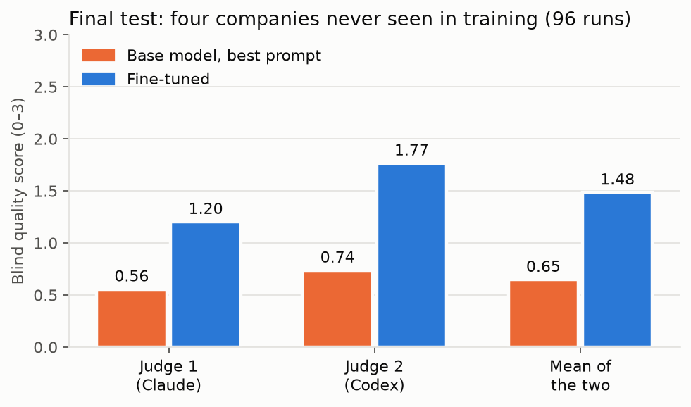
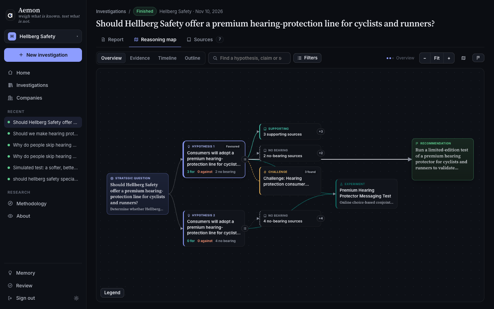
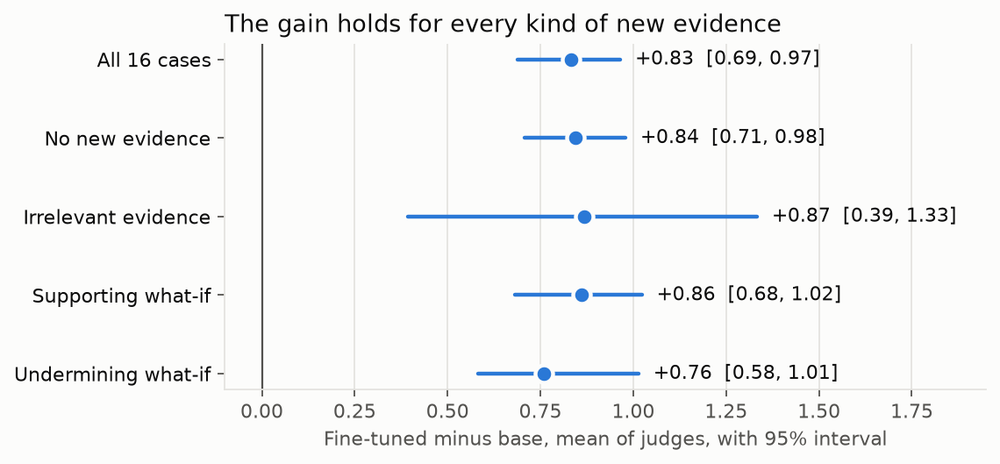
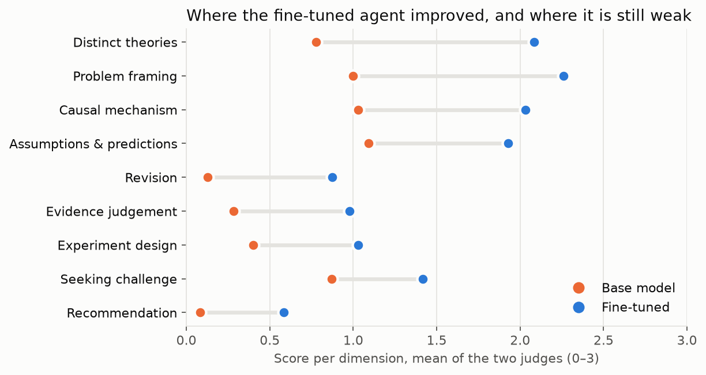
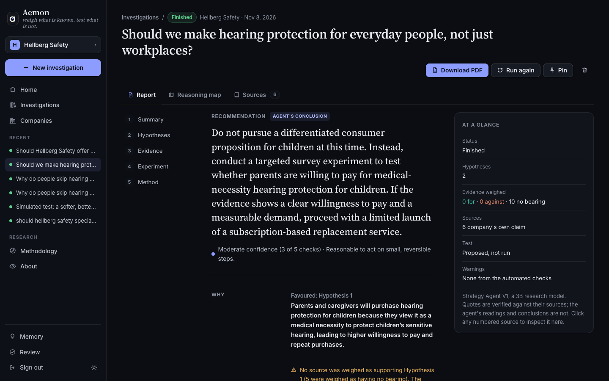

# aemon: teaching a 3B model to investigate a strategy question, with AgentTune and AuditKIT


*weigh what is known. test what is not.*

Team Two-eyed Ravens · Lexsi AI Hackathon, Track 3 (Agentic Fine-Tuning) · November 2026

> **Result in one line.** On four companies it never saw, under the same investigation setup, the fine-tuned Tiny Aya
> agent scored **1.48** against the best-prompted base model's **0.65** on a 0–3 blind LLM rubric (mean of two judges;
> difference **+0.83, 95% interval 0.69 to 0.97**), and was higher at every company. A second frozen test on twelve
> more companies gave **+0.52 [0.33, 0.70]**. Sixteen companies support only a limited claim about generalisation,
> and nothing here is about business outcomes.

| | |
|---|---|
| Code and full repository | [github.com/HatemSaadallah/aemon](https://github.com/HatemSaadallah/aemon) |
| **Live demo** | **[saadallah-r-hatem--aemon-serve.us-east.modal.run](https://saadallah-r-hatem--aemon-serve.us-east.modal.run/)** (sign in with the test account from our submission; it runs on CPU and sleeps when idle, so the first page takes a moment and a new investigation takes several minutes) |
| Model | [HatemSaadallah/tiny-aya-global-strategy-agent](https://huggingface.co/HatemSaadallah/tiny-aya-global-strategy-agent) |
| Dataset | [HatemSaadallah/strategy-agent-investigations](https://huggingface.co/datasets/HatemSaadallah/strategy-agent-investigations) |
| Collection | [aemon: a strategy-investigation agent](https://huggingface.co/collections/HatemSaadallah/strategy-investigation-agent-6af0d2ab19339ae58d020326) |
| Paper | [docs/PAPER.pdf](https://github.com/HatemSaadallah/aemon/blob/main/docs/PAPER.pdf) |
| Recorded investigations | [docs/replays/](https://github.com/HatemSaadallah/aemon/blob/main/docs/replays/README.md), readable here with no GPU |
| Every decision, dated | [docs/DECISIONS.md](https://github.com/HatemSaadallah/aemon/blob/main/docs/DECISIONS.md) |

| **+0.83** | **+0.52** | **28 of 48** | **$0.03** | **30×** |
|:---:|:---:|:---:|:---:|:---:|
| blind quality over the best-prompted base model on the first frozen test (0–3 scale, 95% interval 0.69 to 0.97) | on a second frozen test, 12 more unseen companies (0.33 to 0.70) | investigations finished with an accepted recommendation, against 4 of 48 for the base model | per investigation, self-hosted on one A100 slice: about 8 times less than the closed model we measured | faster than its teacher per GPU |





**In brief**
- **What it is.** A 3.35B-parameter open model that investigates a strategy question step by step inside an
  environment that checks its work: every quote must match a source, rival explanations must differ, and a simulated
  result cannot stand in for real evidence.
- **How it was made.** A stronger teacher (Command A+) ran investigations through the same tools; only runs that
  replay exactly became training rows; AgentTune distilled them into a LoRA adapter; AuditKIT replays every
  evaluation run.
- **What was measured.** Two frozen, run-once tests on 16 unseen companies, scored blind by two LLM judges that first
  had to rank sound investigations above flawed ones.
- **The best system so far uses two adapters.** "Dig then reason" lets version 1 gather the evidence and a second
  adapter, trained with a second teacher, do the reasoning. It is clearly better than version 1 on the second test
  (1.43 against 1.07, +0.36 [0.22, 0.51]) and on development, and level with it on the first test. It was built after
  the frozen results, so we report it as a later system, not as the headline.
- **What it costs.** About $0.03 and 66 seconds per investigation on one A100 slice, roughly 8 times less than the
  closed model we measured.
- **What does not work yet.** About 4 in 10 runs stop before a recommendation, and almost none pass every mechanical
  check. Section 7 says why, and what we tried after the tests (a second teacher, adapter switching, a status check),
  including what failed.

The agent is Tiny Aya Global fine-tuned on a teacher's investigations to work through a strategy question the way a
careful analyst would. The name is a nod to Maester Aemon, a counsellor known for sound judgement in unusual
situations.

---

## 1. Problem and approach

Asked whether a manufacturer should take its technology into a new market, language models tend to produce
consulting prose: lists of factors, confident market sizes with no source, and evidence collected only for the answer
they started with. Strategy research describes a better habit (Camuffo, Cordova, Gambardella and Spina, 2020, *A Scientific
Approach to Entrepreneurial Decision Making*, Management Science; Camuffo, Gambardella and Pignataro, 2024,
*Theory-driven strategic management decisions*, Strategy Science): frame the decision and its real alternatives; state rival causal
theories of who would change their behaviour and why; derive predictions that tell the theories apart; look for
evidence against the favoured theory; design a test with a decision rule when information is worth its cost; and
revise when new evidence arrives.

**Track 3 problem statements addressed:** mainly *agentic distillation* (a stronger teacher's agent trajectories
distilled into a small local student), with *efficient trajectories* (fewer redundant, looping and failed calls) and
*workflow and decision agents* (a multi-step investigation with rules and a full audit trail).

**The question we test:** can agentic fine-tuning teach that procedure to a small model, beyond what a stage controller
and the best prompt already achieve?

**The framework behind the procedure.** Camuffo, Gambardella and Pignataro (2024) formalise a theory as a restriction
on beliefs: stating that one thing causes another rules out parameter values, which raises or lowers the expected
value of acting, and an experiment is worth running only while the theory's value is close to its rival's. The paper
([docs/PAPER.pdf](https://github.com/HatemSaadallah/aemon/blob/main/docs/PAPER.pdf), section 2) works through their example.

**How the agent carries this out.** The agent follows these steps in words, with tools and evidence; neither it nor
the harness computes a Bayesian update, because that would need an invented network and invented numbers, and assumed
ratios could create the very revision we want to measure. Instead, when it states its position and again after a
what-if result, the agent rates each theory on a five-point scale (very unlikely, unlikely, uncertain, likely, very
likely). The scale is a signal within one run, not a calibrated probability.

**The setup.**
- **An investigation environment** with twelve tools (`read_brief`, `frame_problem`, `search_evidence`, `read_source`,
  `add_theory`, `assess_evidence`, `challenge_theory`, `propose_test`, `decline_test`, `state_position`,
  `revise_theory`, `finish`) over a dossier of public records (1,334 when version 1 was trained and first tested; 1,958 now). Quotes must match a source exactly; theories must
  give distinct causal explanations; a simulated what-if result may change beliefs but cannot support a recommendation
  about real demand. Refused calls return the reason.
- **A stage controller** that offers the tools of the current stage: brief, frame, read, theories, assessment,
  challenge, test, position, new evidence, conclusion.
- **A teacher**, Command A+ (Apache 2.0), run with llama.cpp on an NVIDIA A100 (80 GB) through the same tools. Every teacher
  investigation is replayed against the environment, and only investigations that replay exactly and reach an
  accepted finish become training data.
- **The student**, Tiny Aya Global, fine-tuned with AgentTune (LoRA) on the teacher's tool calls, then evaluated with
  AuditKIT, executable checks and two blind LLM judges.

## 2. Hackathon repositories used

**AgentTune** (`src/aemon/training/train.py`, `training/masking_gate.py`)
- `agenttune.agentic.distill_trainer.create_distill_trainer` builds the distillation trainer (TRL SFT with PEFT LoRA)
  from our rows; `agenttune.agentic.events` (`Event`, `EventLog`) records each investigation as an event log.
- Loss is computed only on the target tool call; the context is masked. A masking gate checks this on real rows before
  any training run.

**AuditKIT** (`src/aemon/evaluation/diagnostics/audit.py`)
- `AgentEvalRunner`, `AgentCase`, `AgentEvalSpec` and `episode_from_eventlog` run every evaluation episode through
  AuditKIT; a `CustomPredicate` replays the full event log through our environment and requires every tool result to
  reproduce.
- Diagnostic scorers on every run: `tool_call_validity`, `redundant_tool_calls`, `agent_loop_detection`,
  `tool_permission`. Every development and final report carries an `auditkit` block (0 replay mismatches throughout).

**CuratorKIT** (`src/aemon/rows/curate.py`)
- Decides which training rows to keep and never rewrites one: exact deduplication on (state, target call) and its
  secrets gate, with its run record (manifest, provenance, checksums). On version 1's rows it keeps 3,958 of 4,302;
  all 344 dropped rows are exact duplicates. It was added after the evaluated adapters were trained, for the next
  training run, so the results below do not depend on it.

The three connect: the AgentTune event logs that produce training rows are the same logs AuditKIT replays, and
CuratorKIT filters the rows built from them.

## 3. Models and licences

| Model | Role | Version | Licence |
|---|---|---|---|
| Tiny Aya Global (CohereLabs) | student | `CohereLabs/tiny-aya-global`, revision af89d21; bf16 GGUF for evaluation | CC-BY-NC-4.0 |
| Command A+ (Cohere) | teacher | Q4_K_M GGUF (about 135 GB), weights sha256 recorded in every row | Apache 2.0 |
| Claude (Anthropic, `claude-opus-5-5`) | blind judge; earlier, a workflow control | API | proprietary; **no Claude output is ever training data** (provider terms), enforced by the provenance checks |
| Codex (OpenAI, `gpt-6-astra`, codex-cli 0.166.0) | blind judge | CLI, sandboxed, no repository access | proprietary; evaluation only |
| DeepSeek V4-Pro (`deepseek-v4-pro`) | second teacher, for the exploratory version 3 only | hosted API | proprietary; its investigations pass the same replay checks |
| Claude Code (`claude-opus-5-5`) and Codex (`gpt-6-sol`) | blind judges for the exploratory comparisons | CLI, no tools, no repository access | proprietary; evaluation only; each qualified separately (19 of 20 and 20 of 20) |

## 4. Data, cases and licences

- **Dossier** (`data/dossier/evidence.json`): public records, each with its URL, date and an excerpt. Version 1 was
  trained and first tested on 1,334 of them (935 independent observations, such as standards, regulatory filings,
  studies and trade press; 399 company claims, kept apart so a theory cannot rest only on what a company says about
  itself). With the second test's companies and the later training cases it now holds 1,958 (1,246 and 712). Records
  written after a decision date are flagged.
- **Cases**: 137 development cases on 64 companies, plus 16 held-out cases on 4 companies. Each case is a company and a
  question with search and test budgets, and some deliver a what-if result after the agent states a position
  (irrelevant, supporting or undermining). Every case declares in advance whether a test is worth its cost.
- **Splits by company**: 58 training companies, 6 validation companies (Hellberg, Neumann, Jotun, Tanita, Deere, ACR)
  for the development choices, and 4 final-test companies (Aquaporin, Electrolux Professional, RATIONAL, Simonelli),
  frozen by digest (`docs/final_test_freeze.json`, dce26d4f…) before any model ran on them.
- **Training data**: 174 accepted teacher investigations, giving 4,302 rows; training used the 3,891 rows from 158
  investigations on 57 training companies, plus 51 correction rows (a teacher showing a valid next step from a state
  where the student had looped). The 411 validation rows were kept out.
- **Second test set**: 24 cases on 12 further companies, frozen by digest (`docs/test2_freeze.json`) before any run.
- **Rights**: excerpts are short quotations from public sources (median 24 words, at most 100), each with its
  publisher and link. The dossier is published in full, so anyone can rerun what the evaluated runs read.

## 5. Model artifacts

Collection: [aemon: a strategy-investigation agent](https://huggingface.co/collections/HatemSaadallah/strategy-investigation-agent-6af0d2ab19339ae58d020326).
Model: [HatemSaadallah/tiny-aya-global-strategy-agent](https://huggingface.co/HatemSaadallah/tiny-aya-global-strategy-agent)
(a derivative of Tiny Aya, so CC-BY-NC-4.0):
- the LoRA adapter (`adapter_model.safetensors`, `adapter_config.json`; sha256 740c4a9b…);
- the converted GGUF adapter for llama.cpp (`tiny-aya-global-strategy-lora-bf16.gguf`, sha256 41794b57…), the exact
  file evaluated on the final test;
- the tokenizer, chat template and model card. Training and evaluation configurations and the job scripts are in the
  code repository.

## 6. Data artifacts

Dataset: [HatemSaadallah/strategy-agent-investigations](https://huggingface.co/datasets/HatemSaadallah/strategy-agent-investigations)
(in the same collection):
- the training rows: 4,302 from the Command A+ teacher, 51 correction rows, and 3,611 (plus 262 for validation) from
  the DeepSeek V4-Pro teacher, each bound to its teacher episode;
- the dossier in full (1,958 records, byte-identical to the one in this repository) and every case: 207 development,
  16 final-test and 24 second-test cases, with both freeze files;
- the second teacher's investigations (transcripts, provenance, request logs);
- evaluation runs, blinded judge packets, judge outputs and reports for every campaign: development, both frozen
  tests, version 3, adapter switching and the combined system;
- `MANIFEST.json`, with the sha256 of each private original and of its published copy.

## 7. Experiments and findings

### Early development (small runs, diagnostic only)
- **The untrained model cannot do the task.** In an open workflow it quit after a step or two; under the stage
  controller it stalled, mostly by repeating a theory or search it had already made.
- **Full chat histories did not fit.** Late-stage rows exceeded 8,192 tokens and were refused rather than truncated, so
  most conclusion rows were lost. We replaced the history with a compact state (theories, quotes, tests and revisions in
  full, everything else summarised), which kept every row.
- **Loops at temperature 0.** The first fine-tuned runs went much deeper but repeated refused calls. We added
  correction rows and made the state say plainly that rereading a source returns the same text.
- **A better teacher.** Aya Expanse 32B followed the workflow but reasoned weakly and was rejected as a teacher;
  Command A+ replaced it.

### Controls that the result rests on
- **Conversion check.** Every evaluated adapter was converted to GGUF and replayed against the PEFT adapter on the GPU:
  effect cosine at least 0.99 and probability-weighted residual at most 0.15 on every point, plus a weight-file audit.
  The final adapter passed (cosine 0.9990, residual 0.080), and the evaluated file is byte-identical to the gated one.
- **Judges.** Each judge first scored 20 matched pairs of investigations, sound and flawed, and had to rank the sound
  one higher in at least 17. Claude did so in 20 of 20 (after its output limit was raised and it was requalified),
  Codex in 20 of 20. Packets carry no model name; the key stays outside the judges' reach.

### Development (6 validation companies, 15 cases, one attempt each)

| Arm | Finished | Quality, mean of two judges |
|---|---|---|
| Base, compact prompt | 0 of 15 | 0.14 |
| Base, staged prompt | 0 of 15 | 0.43 |
| Earlier adapter | 6 of 15 | 1.09 |
| **Final adapter** | 7 of 15 | **1.29** |

By the preregistered rule (higher mean judge score) the staged prompt became the base and the final adapter the
trained arm. The two adapters were not distinguishable (+0.20, interval −0.09 to 0.53).

### Final test (4 held-out companies, 16 cases, 3 attempts, 96 runs, run once)

| | Base, staged prompt | Fine-tuned | Difference, paired, 95% case-cluster bootstrap |
|---|---|---|---|
| Claude | 0.56 | 1.20 | +0.64 [0.51, 0.77] |
| Codex | 0.74 | 1.77 | +1.03 [0.87, 1.18] |
| **Mean of judges** | **0.65** | **1.48** | **+0.83 [0.69, 0.97]** |
| Finished investigations | 4 of 48 | 28 of 48 | |

- Every company is higher under both judges (mean of judges: Aquaporin +1.10, Simonelli +0.98, RATIONAL +0.66,
  Electrolux Professional +0.60), and every kind of new evidence (no new evidence +0.84, irrelevant +0.87, supporting
  +0.86, undermining +0.76).
- The judges agree on the ordering (Spearman 0.94 over 95 runs scored by both).
- The largest gains are in distinct theories, framing, causal mechanism and revising on new evidence; the weakest
  dimensions for the trained agent remain the recommendation, revision, experiment design and judging evidence.






**How each run ended** (48 runs per arm; a run is refused a call when it breaks a rule, and stops after repeated
refusals, at the context limit or at the turn limit):

| | Base, staged prompt | Fine-tuned |
|---|---|---|
| Finished with an accepted recommendation | 4 | 28 |
| Stopped after repeated refused calls | 19 | 11 |
| Stopped at the context limit | 25 | 0 |
| Stopped at the turn limit (45) | 0 | 9 |
| Mean calls per run | 20.2 | 35.4 |
| Refused calls, all runs | 279 | 242 |

**Do beliefs move the right way when a what-if arrives?** In the 36 runs per arm whose case delivers a simulated
what-if result, the base model reached it in 11 and the fine-tuned model in 28. A direction check compares the
affected theory's five-point belief before and after: undermining evidence should not raise it, supporting evidence
should not lower it. Of the fine-tuned runs where both beliefs were stated, 6 of 6 moved in the allowed direction (3
undermining, 3 supporting), and in 2 a belief was missing before or after; none moved the wrong way. The base model
stated no before-and-after pair. This is a direction check only, not a quality score: a weak result may rationally
change nothing, and the blind judges score revision as part of the rubric.

### Cost: the fine-tuned agent against a closed model (`reports/cost/roi.json`)

Measured on the final test, one investigation by the fine-tuned agent reads about 121,700 prompt tokens and writes about
2,900 over 35 tool calls, in **66 seconds on one A100 slice**, one investigation at a time: about 54 an hour.

| | per investigation | per 10,000 investigations |
|---|---|---|
| **Fine-tuned Tiny Aya, self-hosted** (A100 40 GB, Oct 2026 median $1.76/h; range $0.89-$3.67) | **$0.032** ($0.016-$0.068) | **$324** (184 GPU hours; $164-$676) |
| Claude Opus 5.5, measured on our earlier control run (15 investigations, $3.73) | $0.25 | $2,483 |
| Claude Opus 5.5, the same token volume at list price, no caching ($4 / $20 per million) | $0.54 | $5,442 |
| Claude Sonnet 5.5, the same token volume ($2 / $10) | $0.27 | $2,721 |
| Claude Haiku 5.5, the same token volume ($0.10 / $0.50) | $0.014 | $136 |

- Self-hosting costs about **8 times less than the measured Opus run** and 8 to 17 times less than Sonnet or Opus at
  the same token volume. Per finished investigation (28 of 48) it is about $0.056.
- **Haiku 5.5 at list price is cheaper than renting a GPU for this agent**, and we did not measure its quality on this
  task; the case for self-hosting against it rests on running offline and keeping the case data local, not on price.
- The closed models are not quality-matched: Claude finished all 15 control investigations on the earlier harness,
  against the fine-tuned agent's 28 of 48 here.
- The teacher shows the other side of distillation: Command A+ took about 2 hours 10 minutes per batch of four on the
  same kind of slice (about 1.8 investigations an hour), so the student runs roughly **30 times faster** per GPU.
- Not measured: running several investigations at once on one GPU, which llama.cpp supports and would lower the
  self-hosted cost further.

Prices: Anthropic list prices as of October 2026; GPU prices from aggregator snapshots (amcompute.com, October 2026;
gpu-cost.pages.dev, June 2026), which change often.

### What still fails, and why (`docs/FINAL_TEST_DIAGNOSIS.md`)
*This is the diagnosis of version 1 on the first frozen test, written on 8 November right after it. What we did about
each failure since then is noted in italics.*

Only 1 of 48 trained runs passes every mechanical check (all-checks success was also rare in the teacher's training
data, 1 of 223, on other cases), and 20 of 48 stop before a recommendation. One check is itself flawed: five of six predictions-overlap
failures involved contrasting predictions that the checker incorrectly treated as identical. This does not establish
that the experiments were otherwise sound. The frozen numbers are reported as computed. Several failures trace to behaviour the
training data never showed:
- **Never declining a test.** No training example declines one. The labels need care: for Aquaporin, declining
  follows from its insolvency and bankruptcy, recorded in the dossier, yet **no run of either arm found those records**
  and every finished trained run recommends investing. For RATIONAL the no-test label is the case author's judgement
  and is contestable. *Since then: the company status check below makes every run read those records.*
- **Little what-if evidence that matters.** Only 8 of 205 teacher investigations had supporting or undermining
  results; the student handles irrelevant evidence correctly and revises the wrong theory on Aquaporin's pair. *Still
  open: it needs new training examples.*
- **Simulated-only finishes.** Eight runs try to finish citing only the simulated result, are refused, and repeat until
  the error limit. *Still open.*
- **Rereading.** Nine runs reach the turn limit; in eight of them the agent rereads the same few sources. *Since
  then: the app refuses a third read of one source; the evaluated setup is unchanged.*

### Second frozen test (12 new companies, 24 cases, 3 attempts, 144 runs, run once; `docs/test2_freeze.json`)
A second test on companies never used for training, development or the diagnosis above. It was frozen before any run,
under the same judges, rubric and rule.

| | Base, staged prompt | Fine-tuned | Difference, paired, 95% case-cluster bootstrap |
|---|---|---|---|
| Claude | 0.48 | 0.89 | +0.41 [0.24, 0.57] |
| Codex | 0.66 | 1.29 | +0.63 [0.43, 0.84] |
| **Mean of the two judges** | **0.57** | **1.09** | **+0.52 [0.33, 0.70]** |
| Finished investigations | 2 of 72 | 32 of 72 | |
| Finished and passing every check | 1 | 4 | |

- The fine-tuned agent is higher for 10 of 12 companies on the mean of judges. Franke Coffee (−0.05) and Hoshizaki
  (−0.10) are slightly lower.
- The gain is smaller than on the first test (+0.83 there on the mean of judges). The two judges rank the runs alike
  (Spearman 0.95 over all 144).
- The weakest dimensions are the same as before: the recommendation (0.03 → 0.44), experiment design (0.22 → 0.50) and
  judging evidence (0.28 → 0.39).

### Version 3: a second teacher (exploratory; version 1 stays the evaluated model)
After both tests we trained a third adapter by continuing version 1 on everything from both teachers: version 1's rows
plus 3,611 rows from 154 replay-exact DeepSeek V4-Pro investigations on 69 companies. On its development screen it
did not pass the adoption rule fixed in advance (blind quality 0.83 against version 1's 1.05), so it was not adopted.
We then ran it on both test sets anyway, labelled exploratory, with base, version 1 and version 3 rejudged together
blind by two judges qualified for this purpose (Claude Code and Codex on `gpt-6-sol`).

| Mean of the two judges | Base | Version 1 | Version 3 | Version 3 minus version 1 |
|---|---|---|---|---|
| Test set 2 (72 runs per arm) | 0.56 | 1.06 | 1.48 | +0.42 [0.24, 0.60] |
| Final test (48 runs per arm) | 0.62 | 1.46 | 1.33 | −0.13 [−0.31, 0.04] |

- The two test sets disagree: version 3 is clearly higher on test set 2 and not distinguishable from version 1 on the
  final test, where most of the gap is one company (Aquaporin, −0.41).
- Version 3 makes fewer calls and far fewer refused ones, but it learned the second teacher's direct style without
  its recovery: when a call is refused it repeats it. Its theories are also thinner.
- Because these runs were decided after version 1's results were known, they select nothing.

### Switching adapters during a run (development, then test set 2)
The two adapters fail differently, so one llama.cpp server holds both and the runner picks one per turn from the stage
and the count of refusals in a row; it never sees a judge or the case. On the 15 development cases (3 attempts, 45 runs
per arm, Claude Code judge):

| Arm | Blind quality | Finished of 45 |
|---|---|---|
| Version 1 | 1.06 | 24 |
| Version 3 | 0.86 | 19 |
| Version 3, a stuck turn goes to version 1 | 1.17 | 33 |
| Version 1, a stuck turn goes to version 3 | 1.20 | 26 |
| **Dig then reason**: version 1 gathers the evidence, version 3 reasons | **1.24** | 33 |

Dig then reason was higher than both single adapters on development (+0.17 [0.02, 0.35] over version 1, +0.38
[0.13, 0.62] over version 3), so it was the rule taken to a test.

### A company status check (the Aquaporin failure)
On the final test no run of either arm found Aquaporin's insolvency records, 0 of 144, and every finished trained run
recommended investing. We added one step after framing: a fixed search for the company's own current position
(records that name the company, newest first), and a required `company_position` text in the final answer. With it
every run reads those records. On Aquaporin, version 3 with the check finished 3 of 12 runs and all three said "do not
commit"; without it, it finished 9 of 12 and all nine said "invest". The check costs finished runs: on development,
version 1 finished 14 of 45 with it against 24 without. These Aquaporin numbers are a diagnostic of the fix, not a
test, because that company informed the design.

### The combined system on test set 2 (a system built after the frozen results)
The system: version 1 for the brief, frame, status and evidence stages, version 3 for every later stage, with the
status check on. The plan was fixed before any run: test set 2, five arms judged together blind by both judges (342
packets from 360 runs, none missing), primary comparison the combined system minus version 1. Nothing in the system
was selected on test set 2, but that set had been run before.

| Arm (72 runs each) | Mean of judges | Claude Code | gpt-6-sol | Finished |
|---|---|---|---|---|
| Base, staged prompt | 0.56 | 0.48 | 0.63 | 2 |
| Version 1 | 1.07 | 0.87 | 1.26 | 32 |
| Combined system (dig then reason, with the status check) | 1.28 | 1.07 | 1.49 | 37 |
| Dig then reason, without the status check | 1.43 | 1.16 | 1.70 | 43 |
| Version 3 | 1.48 | 1.21 | 1.74 | 57 |

- **Primary comparison, combined minus version 1: +0.22 [−0.00, 0.46].** The interval includes zero, so the combined
  system is not shown to be better than version 1. It is uneven: higher at 7 of 12 companies (Hoshizaki +1.19, Franke
  Coffee +0.94, Belimo +0.82) and lower at 5.
- Dig then reason without the check is clearly higher than version 1 (+0.36 [0.22, 0.51]) and level with version 3
  alone (1.43 against 1.48), so on this set the switching adds nothing over version 3.
- The status check costs about 0.15 (combined minus dig −0.15 [−0.35, 0.06]) and six finished runs.
- The two judges rank the runs alike (Spearman 0.90 over 360 runs).
- **On the final test the picture reverses** (secondary and labelled, since Aquaporin informed the status check; 48
  runs per arm, 231 packets, Claude Code judge only so far, the second judge pending): version 1 1.18, dig then reason
  1.13, version 3 1.06, combined 1.03, base 0.54. No trained arm is distinguishable from version 1 there (combined
  −0.15 [−0.32, 0.01], dig −0.06 [−0.23, 0.12], version 3 −0.12 [−0.27, 0.02]), and most of each gap is Aquaporin.
- **Reading across both sets:** dig then reason is the best system we have: clearly higher than version 1 on test set
  2 and on development, and level with it on the final test. Version 1 remains the frozen, evaluated model, and no
  later system beats it on the final test. The status check fixes what it was built for and costs finished runs.

### A recovery controller does not fix the remaining failures
We tested five controller-side recovery aids on development cases under a pre-registered rule (masking rereads,
progress notes, step-budget awareness, citation repair, and all four). The best, step-budget awareness, rescued 15 of
28 stuck runs against 6, but end to end it changed 8 of 45 runs and left blind quality unchanged (+0.006
[−0.017, 0.031]): the extra finishes rush a templated test. More finishes are not better investigations; the
remaining failures need training, not a controller. Full report: [docs/RECOVERY_REPORT.md](https://github.com/HatemSaadallah/aemon/blob/main/docs/RECOVERY_REPORT.md).

### Limits of our own checks
- **The mechanical experiment check is too lenient**: 8 of the 9 tests it accepts on development fail stricter
  design screens. The frozen numbers use the original check; later comparisons also report a stricter one.
- **Evidence-kind labels are about 80% reliable**, by a blind relabelling of 60 training records.

Details: [docs/RELIABILITY_REPORT.md](https://github.com/HatemSaadallah/aemon/blob/main/docs/RELIABILITY_REPORT.md) and
[docs/EVIDENCE_KIND_GUIDE.md](https://github.com/HatemSaadallah/aemon/blob/main/docs/EVIDENCE_KIND_GUIDE.md).

### What else we tested
Specialist adapters per stage (proposed; the data per stage was too thin), a Socratic coach (proposed, not built), more teacher data
versus the clearer state (inconclusive), and scripted always-keep and always-revise policies as negative controls on
the development cases (they could not run on the held-out cases, which we report as a deviation).

Tooling, tested for a later training run that was not made: **Unsloth** (the same rows, LoRA and seed through
AgentTune's trainer, 60 steps: 23% faster per step, 8.1 GB peak memory against 11.6, losses within 0.003) and
**CuratorKIT** row curation (above). A further teacher run with the status check was started and stopped before it
produced data, so no version 4 exists. Runs, metrics and adapters are tracked in MLflow (`ops/mlflow/`).

### Lessons
- The controller, the guards and replay made the teacher's data trustworthy, and the same machinery made every
  evaluation run auditable.
- Measuring with two qualified blind judges, a frozen plan and a one-shot test kept us from reading noise: several
  development differences that looked real were not.
- Most remaining failures are gaps in the training data, not in the amount of it.
- Results did not transfer cleanly between sets: version 3 and the switching rule each looked different on
  development, test set 2 and the final test. One set would have misled us in either direction.

## 8. With more credits

The diagnosis gives a concrete plan, each part confirmed on development cases before new training examples are chosen,
and measured on fresh evaluation cases, since the four final-test companies have now informed the diagnosis:
1. Justified propose-versus-decline examples, where the decision follows from explicit constraints and the value of
   the information, allowing either decision when warranted.
2. Balanced supporting and contradicting what-if evidence, explicitly linked to the theory it bears on.
3. Recovery from simulated-only citations, separating a hypothetical belief update from the real evidence behind a
   recommendation.
4. Recovery from rereading, using the information already gathered.
5. Searching for the company's current position before theorising (the Aquaporin failure). The status check above
   does this at run time; training it in should remove its cost in finished runs.

More teacher runs of the same kind would not address these gaps; more of these specific cases would. Before and after
would be measured exactly as here: the same frozen judges and rule, on new held-out companies.

**What we tried after the tests, and what it showed (10 November; `docs/RELIABILITY_REPORT.md`).**
- **Corrective distillation.** We built teacher examples at states where version 1 itself went wrong: invented numbers,
  experiment design, evidence kind, and recovery after refusals.
  - Each was checked for provenance, exact replay and split, then reviewed against substantive criteria.
  - Of 90 examples the mechanical checks accepted, an advisory review rated 3 strong, and spot checks confirmed its
    reasons.
  - The teacher (Command A+) makes the same errors it was meant to correct: it calls encyclopedia and news text
    "independent study", relies on sources published after the case date, and designs tests that vary only the message.
  - A structured format fixed its truncated test designs, but then it declined tests the cases warrant.
  - We had fixed a threshold of 30 strong examples, including experiment design, before training. It was not met, so
    no version 2 was trained.
- **Auditing version 1's own data.** The same weaknesses are in the teacher data version 1 was trained on:
  - 74% of the teacher's recommendations use a number from no source;
  - 38% of its evidence kinds match the annotation;
  - 47% of its recommendations in historical cases cite a source published after the case date, and about half of those
    quotes reveal later outcomes.

  The frozen tests are present-day cases, so their scores are unaffected.
- **An evidence-verification layer, without retraining.** Before the final recommendation, the agent was shown what its
  evidence did not support, and could revise or answer "insufficient evidence". On 45 paired development runs this gave
  19 unsupported recommendations against 20, the same validated completion, and no abstention. The 3B model rewrote the
  text but not the evidence behind it. The app shows these findings to the reader instead.
- **Two more runtime attempts, both rejected under rules fixed in advance.**
  - Constraining the favoured theory to those the agent's own weighings support collided with an existing guard and
    halved the finishes.
  - Novelty-first search doubled the sources the agent was shown, but it weighed fewer of them, found contradicting
    evidence in the same 2 of 45 runs, and finished with every check cleared in 0 runs against 3.

The lesson for distillation: a teacher's errors pass to the student, and they cannot be filtered out afterwards. A
stronger or human-corrected teacher for evidence judgement is the next step, not more of the same data.

## 9. Team

Team Two-eyed Ravens: Hatem Saadallah and Nour Jennane, Master's students in artificial intelligence and AI
researchers.

Built with AgentTune, AuditKIT and CuratorKIT (Lexsi Labs), Tiny Aya and Command A+ (Cohere), PEFT, TRL and llama.cpp,
on NVIDIA A100 GPUs (40 GB and 80 GB slices, Slurm). Claude (Anthropic) and Codex (OpenAI) served as blind judges and as coding assistants.

---

## The app

Try it at the [live demo](https://saadallah-r-hatem--aemon-serve.us-east.modal.run/), or run it yourself: `./app/run.sh` starts the interface at http://127.0.0.1:8000: pick a company, ask a question, and watch the
investigation step by step, then read the report, the reasoning map and the sources. It runs the two-adapter system
described in section 7 by default.



## Repository layout

```
src/aemon/environment/   the twelve guarded tools, the stage controller, the cases and the dossier search
src/aemon/agent/         the runner, tool schemas, adapter routing, model clients
src/aemon/teacher/       teacher investigations (Command A+ locally, DeepSeek V4-Pro hosted)
src/aemon/rows/          row building, provenance, coverage checks, CuratorKIT curation
src/aemon/training/      AgentTune distillation training, the masking gate
src/aemon/evaluation/    AuditKIT replay and diagnostics, the conversion gate, blind judging
app/                     the interface (FastAPI and React)
jobs/                    Slurm job scripts for every stage
reports/                 every result: teacher runs, evaluations, judge packets, outputs and reports
docs/                    the paper, the decisions log, plans frozen before each test, model and dataset cards
```

## See an investigation without a GPU

[docs/replays/](https://github.com/HatemSaadallah/aemon/blob/main/docs/replays/README.md) has six recorded runs from the frozen final test, rendered as pages you can
read here on GitHub: every tool call, what the environment accepted or refused and why, the recommendation, and the
blind judges' scores. They include a finished run for each company, the Aquaporin run above, a run that stops on
refusals, and the untrained base model on the same case. They come straight from the saved reports
(`reports/judge/final/`); `python scripts/release/replay_markdown.py` regenerates them, with no model or GPU.

## Run it

```bash
uv venv .venv --python 3.12
uv pip install --python .venv/bin/python -r requirements.lock.txt \
  --extra-index-url https://download.pytorch.org/whl/cu128 --index-strategy unsafe-best-match
./run_tests.sh
```

Serve the base model with the adapter (GGUF, llama.cpp), then run an investigation or open the app:

```bash
llama-server -m tiny-aya-global-bf16.gguf --lora tiny-aya-global-strategy-lora-bf16.gguf --port 8091 --jinja
python -m aemon.agent.run_investigations --prompt compact --cases hellberg-base --output run.json
./app/run.sh   # the app, at http://127.0.0.1:8000 (PDF reports need Chrome or Chromium)
```

## Reproduce

The job scripts in `jobs/` run each stage on a Slurm cluster with A100 GPUs; set `REVISION` to a copy of this code.

1. Teacher investigations: `jobs/command_a_plus.sbatch` (Command A+ Q4_K_M with llama.cpp).
2. Rows and training: `NAME=final COMPACT=1 ROW_PROMPT=compact EPOCHS=2 SAVE=50 sbatch jobs/train_after_teacher.sbatch`.
3. Conversion check: the GGUF adapter is replayed against the PEFT adapter (`jobs/diagnose_conversion.sbatch`,
   `src/aemon/evaluation/conversion/gate.py`).
4. Evaluation: `jobs/eval_adapter.sbatch` with `SPLIT=heldout ATTEMPTS=3`, once with the adapter (`PROMPT=compact`) and
   once without (`PROMPT=staged`).
5. Judging: `python -m aemon.evaluation.judging.packets`, `src/aemon/evaluation/judging/judge_v1/run_campaign.py`,
   `python -m aemon.evaluation.judging.report`. All reports are in `reports/judge/`.

The dossier in this repository is the one the evaluated runs read: each record keeps its source, URL and date with
the excerpt the agent quotes from.

## Licence

Code: Apache 2.0. The adapter derives from Tiny Aya Global and is CC-BY-NC-4.0.
